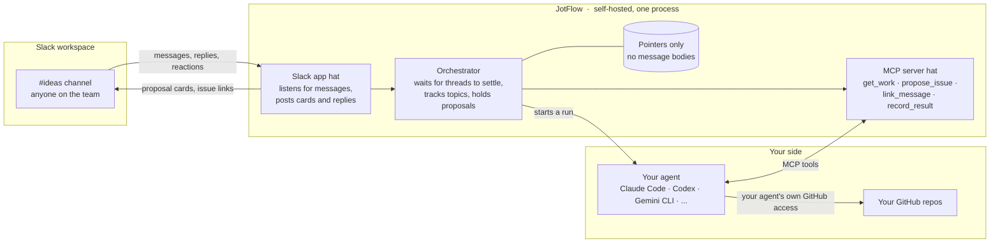
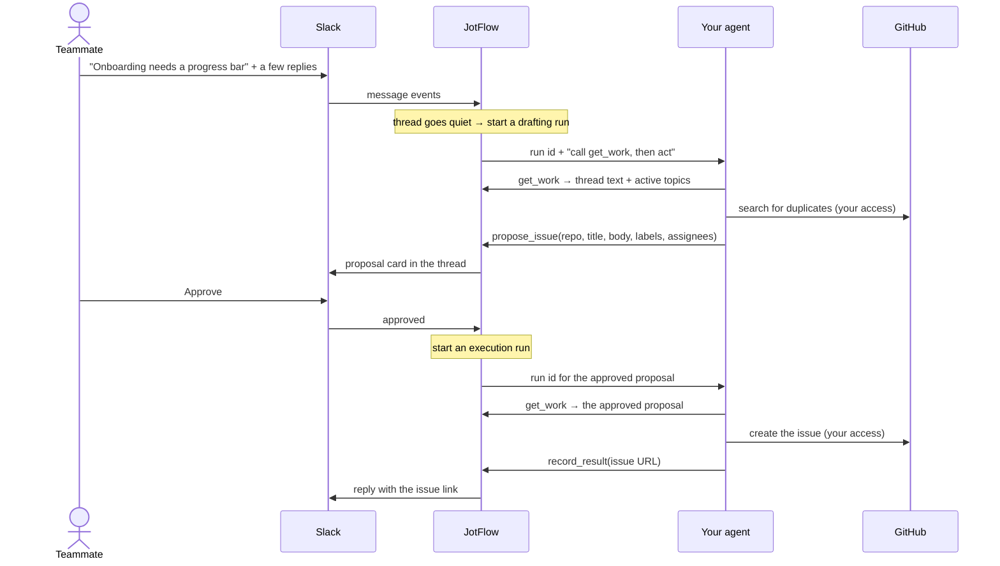

# JotFlow

**Turn team chat into GitHub issues.**

JotFlow is a self-hosted, agent-agnostic bridge between a shared Slack channel and your GitHub repositories. Anyone on the team, engineer or not, drops an idea, bug, or request into the channel. JotFlow watches the conversation, correlates follow-up messages and replies to the same topic, and has *your* AI agent draft the corresponding GitHub issue. A human approves it, or the channel is configured to let it through automatically. Either way, the result is posted back to Slack so everyone sees what was created.

> **Status: milestone 1, installable, in progress.** Setup and `jotflow run` are built and tested offline; the first live check against a Slack workspace is next. Drafting and approving issues arrives in later milestones; see the [roadmap](docs/roadmap.md). [docs/architecture.md](docs/architecture.md) is the full design.

## Why

- Agents can now generate issues faster than a small team can track them. People still end up pinging each other on Slack to say "I filed this, go look."
- Non-engineers rarely have a coding agent in a terminal. A Slack channel is something they already use.
- GitHub's own Copilot-in-Slack integration does part of this, but it is closed source, only acts when mentioned, and requires a Copilot Business or Enterprise plan. JotFlow is free, open, runs on your infrastructure, and works with whatever agent your team already has.

## How it works

JotFlow is one self-hosted program wearing two hats: a Slack app that listens to your channel, and an MCP server that your own agent plugs into. Your agent brings its own GitHub access and does the actual writing. JotFlow never touches GitHub.



One idea, start to finish:



In `auto` mode the Approve step is skipped and the card is posted after the issue exists. Follow-up replies in the thread run the same loop and produce update proposals instead of new issues.

The pieces:

1. **Slack app.** Each team creates their own from the included manifest, named and iconed however they like. It is how JotFlow hears messages and posts back. Slack only talks to installed apps, so this part is unavoidable.
2. **Orchestrator.** Waits for a thread to settle before acting, keeps a per-channel index of active topics so related messages land on the same issue, and holds proposals until they are approved.
3. **Whiteboard MCP server.** The agent's only way to act. Tools to fetch the work, propose an issue or an update, link a message to a topic, ask the channel a question, and report the result of a write. Any MCP-capable agent can drive it.
4. **Your agent.** Launched by JotFlow in headless mode with the MCP server attached, using a preset for your CLI of choice. It reads, drafts, searches your repos for duplicates, and performs the GitHub writes with the access you already gave it.
5. **Approval gate.** Each channel is in `propose`, `auto`, or `paused` mode. It covers the whole lifecycle: creation, description edits, comments, assignment, and labels.

## What a team needs

| Component | Needs | Does not need |
|---|---|---|
| JotFlow | A Slack app in your workspace, created from the included manifest. It reads messages and channel details in the channels you invite it to, posts messages, adds reactions, pins its help message, looks up user names, and has one slash command, over Socket Mode. [manifests/README.md](manifests/README.md) explains each permission. | Any GitHub access |
| Your agent | Whatever GitHub access you already gave it, for example GitHub's MCP server or the `gh` CLI | Any Slack access |
| Your machine | Docker to run JotFlow, and uv or Python 3.12 or newer to run the setup once | A public URL or open ports: Socket Mode connects out to Slack |

## Quickstart

This takes about five minutes, most of it in Slack's settings pages. Every name and id below is made up; use your own.

### 1. Prerequisites

- **Git**, to clone the repository.
- **Docker** with Compose v2.24 or newer. Check with `docker compose version`.
- **uv**, which also fetches Python 3.12 or newer if you don't have it. See [uv's installation guide](https://docs.astral.sh/uv/getting-started/installation/). Without uv, Python 3.12 or newer with `pip` works too; see the note in step 3.
- Permission to **create apps in your Slack workspace**. Some workspaces need an admin to approve new apps.

### 2. Clone

```
git clone https://github.com/Jnkman787/jotflow.git
cd jotflow
```

### 3. Run the guided setup

```
uv run jotflow init
```

Without uv: `python3 -m venv .venv`, then `.venv/bin/pip install .`, then `.venv/bin/jotflow init`.

Setup asks a few questions. Press Enter to accept the default in brackets, or Ctrl-D to stop. Nothing is saved until the last question, so stopping part-way changes nothing.

1. **The bot's name.** This is how it appears in Slack, for example `Idea Bot`.
2. **Create the Slack app.** Setup prints a link. Open it, pick your workspace, and click **Create**: the manifest is already filled in. If the link doesn't open, choose **Create New App**, then **From a manifest**, at <https://api.slack.com/apps>, and paste the contents of `slack-app-manifest.json`, which setup saved for you.
3. **Two tokens.** In the new app's settings:
   - Under **Basic Information**, in **App-Level Tokens**, generate a token with the `connections:write` scope. It starts with `xapp-`.
   - Under **Install App**, click **Install to Workspace**, then **Allow**, and copy the **Bot User OAuth Token**. It starts with `xoxb-`.

   Paste each one when asked. They stay hidden as you type, and setup checks them with Slack straight away. If a token is wrong, setup says what's wrong and asks again. If a token ever leaks, [manifests/README.md](manifests/README.md) explains how to revoke it.
4. **Channels and repos.** For each channel JotFlow should watch, setup asks for:
   - the channel id. Open the channel, click its name, and find the id at the bottom of **About**. It starts with `C`, or `G` for some private channels. A copied channel link works too.
   - each GitHub repo that channel feeds, as `owner/name` or a GitHub link
   - a short nickname, used in replies like `re: web#42`
   - one line on what the repo covers. When a channel feeds several repos, the agent picks one by this line.
   - which labels a proposal may use. The default, `any`, allows any label that already exists on the repo; the agent never invents labels. A comma-separated list narrows it to just those.
5. **The agent preset.** This names which agent CLI will draft issues, for example `claude-code`. Type `none` for now if you only want to see JotFlow connect; agent runs arrive in milestone 3.

A session looks like this, shortened. Your answers are on the right of each prompt.

```
What should the bot be called in Slack? [JotFlow]: Idea Bot

Create the Slack app. Open this link, pick your workspace, and click Create:

  https://api.slack.com/apps?new_app=1&manifest_json=...

Paste the bot token (xoxb-, hidden):
  Bot token works: @idea_bot in Example Team.
Paste the app-level token (xapp-, hidden):
  App-level token works: Socket Mode can connect.

Channel id: C0EXAMPLE1
  GitHub repo (owner/name): example-org/web
  Short nickname people can type, as in re: web#42 [web]:
  What does it cover? The agent picks a repo by this: The customer web app
  Labels a proposal may use: any existing label, or a comma-separated list to narrow it [any]:
  Add another repo to this channel? [y/N]:
Add another channel? [y/N]:

Agent preset [claude-code]: none

Saved both tokens to .env. Only your user can read that file.
  Also set COMPOSE_FILE there, so `docker compose up -d` mounts jotflow.toml.
Wrote jotflow.toml: 1 channel, 1 repo, no agent preset.
Connected to Slack as @idea_bot in Example Team.
```

Setup writes two files next to `docker-compose.yml`. Neither is committed to git.

- **`.env`** holds the two Slack tokens. Only you can read it, on a Linux or macOS filesystem. On a Windows drive, such as `C:\` or `/mnt/c` in WSL, that mode is not enforced and the folder's Windows permissions decide who can read it. Keep the checkout somewhere private, and in WSL prefer your Linux home directory. Setup also adds a `COMPOSE_FILE` line here, so Docker picks up your `jotflow.toml`.
- **`jotflow.toml`** lists your channels and repos. It holds no secrets. Edit it freely: [jotflow.example.toml](jotflow.example.toml) explains every option.

Running `jotflow init` again is safe. It offers to keep tokens that still work and your existing `jotflow.toml`.

### 4. Invite the bot

In Slack, in each channel you listed, type:

```
/invite @idea_bot
```

Use the bot's handle, which setup printed after `Connected to Slack as`; Slack also suggests it as you type. JotFlow never joins channels by itself. Joining a channel is always a person's choice.

### 5. Start JotFlow

```
docker compose up -d
```

The first start builds the image, which takes a minute or two.

### 6. See it working

```
docker compose logs -f jotflow
```

Post a message in one of your channels. A line like the last one below appears:

```
2026-10-18 09:41:02,118 INFO jotflow.run: watching 1 configured channel(s) as @idea_bot
2026-10-18 09:41:02,604 INFO jotflow.run: connected to Slack over Socket Mode
2026-10-18 09:41:37,250 INFO jotflow.ingest: message channel=C0EXAMPLE1 ts=1760781697.000100 thread_ts=None
```

The log shows where a message was posted and when, never what it says. It does show channel ids and your bot and workspace names, so remove those before pasting logs into a public issue. Adding a reaction logs a `reaction` line in the same way. Press Ctrl-C to stop following the log; JotFlow keeps running. Stop it with `docker compose down`.

To run JotFlow without Docker, use `uv run jotflow run` from the same directory instead of steps 5 and 6.

## Troubleshooting

**Verify a fresh install** with the live check. It posts one marked test message to a channel listed in `jotflow.toml`, confirms JotFlow receives it and logs it without its text, then deletes it. It runs only when you opt in for that run, and in a terminal it asks before posting. Stop JotFlow first. Slack sends each event to only one connection, so a running JotFlow could take the check's event, and while the check is connected JotFlow could miss real messages:

```sh
docker compose stop jotflow
JOTFLOW_LIVE_CHECK=1 uv run jotflow check --live
docker compose start jotflow
```

Run it on the host, not in the container: it refuses inside JotFlow's image, because Compose passes every `.env` line into the container. That refusal guards against accidents; it is not a security boundary. Keep `JOTFLOW_LIVE_CHECK` out of `.env` and your shell profile; the check refuses when `.env` has it. Ctrl-C at the question cancels without posting. Each step prints `ok` or `FAIL` with what to fix. Add `--yes` to skip the question. If `jotflow.toml` lists several channels, pick one with `--channel C0123ABCD`. `uv run jotflow check` without `--live` only checks `.env` and `jotflow.toml`, and posts nothing. The live check refuses to run when `CI` is set, so it never runs in a pipeline.

Every error names what to fix. The common ones:

| You see | What to do |
|---|---|
| `jotflow init is interactive; run it in a terminal.` | Run setup in a terminal window, not through a pipe or a script. |
| `That is an app-level token (xapp-).` or `That is a bot token (xoxb-).` | The two tokens were swapped. Paste the other one. |
| `The bot token is missing these scopes: ...` or `missing this scope` | The app wasn't created from JotFlow's manifest, or the manifest changed. Add the named scopes under **OAuth & Permissions**, or create the app again from the link. Then click **Reinstall to Workspace** and copy the new bot token. |
| `The app-level token is missing the connections:write scope.` | Generate a new app-level token under **Basic Information**, with the `connections:write` scope. |
| `Slack does not recognise this token.` | The token was copied incompletely. Copy it again with the **Copy** button. |
| `could not reach Slack` | Check your network. Behind a proxy, set `HTTPS_PROXY` before running setup. |
| `jotflow.toml has problems:` followed by keys | A hand edit broke the file. Each line names the key at fault. Fix it, or let setup write a new one. The old file is kept as `jotflow.toml.bak`. |
| `configuration problem in environment or .env:` `JOTFLOW_SLACK_BOT_TOKEN: not set` | `.env` is missing or isn't next to `docker-compose.yml`. Run `jotflow init` in the repository folder. |
| `configuration problem in jotflow.toml:` ``file not found; run `jotflow init` to create it`` | The container didn't get your policy file. Check that `.env` has the `COMPOSE_FILE` line. If you removed it, start with `docker compose -f docker-compose.yml -f docker-compose.policy.yml up -d`. |
| Compose says the bind source path for `jotflow.toml` does not exist | Run `jotflow init` before `docker compose up -d`. |
| `jotflow.toml` is a directory, or JotFlow reports `Is a directory` | Compose ran before setup, and Docker Desktop created an empty directory in place of the missing file. Stop JotFlow with `docker compose down` and remove the directory. That may need `sudo`, or Docker Desktop's file access, because Docker created it as root. Then run `jotflow init` and start again with `docker compose up -d`. |
| `Permission denied` on `/etc/jotflow/jotflow.toml` | The container runs as its own user and must be able to read the file: `chmod 644 jotflow.toml`. |
| `not a member of channel C0EXAMPLE1; invite the bot there with /invite @idea_bot` | Invite the bot to that channel. JotFlow keeps running and watches the channels it is in. |
| `could not look up channel ... the app needs the channels:read and groups:read scopes` | The app was created from an older manifest. Add the two scopes under **OAuth & Permissions** and reinstall the app. If Slack shows a new bot token, run `jotflow init` again to save it. |
| `Slack rejected the bot token (...)` or `Slack refused the Socket Mode connection (...)` | A token was revoked or the app was reinstalled. Run `jotflow init` again to save fresh tokens. |
| `FAIL  receive: no event for the test message` from the live check | First make sure JotFlow is stopped, since a running JotFlow can take the event. Otherwise the app is not getting message events. Check **Event Subscriptions** for `message.channels` and `message.groups`, and that Socket Mode is on, then reinstall the app. |
| No `message` lines appear | Check that the channel's id is in `jotflow.toml` and that the bot is in the channel. JotFlow ignores channels it isn't configured for and its own messages. |
| On Windows, Compose ignores the `COMPOSE_FILE` line | Compose separates file names with `;` on Windows. Add `COMPOSE_PATH_SEPARATOR=:` to `.env`, or use WSL. |

## Using it

This is how JotFlow works for the people in the channel once drafting and approval cards land, in milestones 3 and 4.

- **Just post.** Write your idea, bug, or request in the channel like you normally would. JotFlow waits for the conversation to settle, then posts a proposed issue for the team to approve.
- **Steer it if you like.** Start a message with `idea:` or `bug:` to say what it is, `re:` to add to an existing issue (JotFlow's link replies tell you exactly what to type), or `skip:` if it isn't an idea at all. Most people never need these.
- **Forgot the words?** Type `/jotflow help`.

Comments and closures on GitHub do not flow back into Slack yet; that is planned after v1.

## Principles

- **Bring your own agent.** JotFlow never calls an LLM itself. You supply the agent and its credentials.
- **JotFlow's code never uses GitHub credentials.** Your agent runs in its own container with its own GitHub access, and never sees JotFlow's Slack tokens. It emits structured proposals through JotFlow's tools. Once a proposal is approved, JotFlow hands it back to your agent, which performs the write with the GitHub access you already gave it and reports the issue URL back. JotFlow never asks the agent to write anything a human has not approved, unless the channel is in `auto` mode.
- **Store pointers, not messages.** JotFlow keeps Slack message timestamps, topic links, issue numbers, and proposal state. It does not store message bodies. Thread text is fetched from Slack on demand, passed to the agent, and discarded. Logs redact message content by default.
- **The local store is a rebuildable cache.** Every issue carries the Slack permalinks it came from; every linked Slack message gets a reply with the issue URL. Delete the database and the correlation map can be rebuilt from Slack and GitHub.
- **No hosted component, no telemetry.** Nothing phones home.

## Roadmap

The plan lives in [docs/roadmap.md](docs/roadmap.md): five milestones from "installable" to "ready for another team," the decisions each rests on, and what done means for each. Work is tracked as GitHub milestones and issues on this repo.

## Contributing

Issues and pull requests are welcome. See [CONTRIBUTING.md](CONTRIBUTING.md), and point your coding agent at [AGENTS.md](AGENTS.md). Security concerns go through [SECURITY.md](SECURITY.md), not public issues.

## License

[Apache-2.0](LICENSE)

JotFlow is an independent open source project. It is not affiliated with or endorsed by Slack Technologies or GitHub, Inc.
