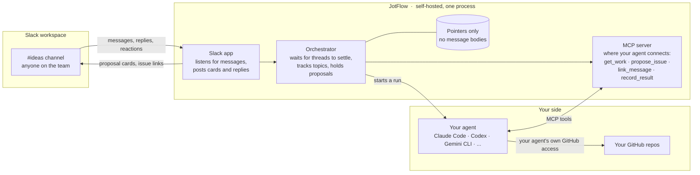
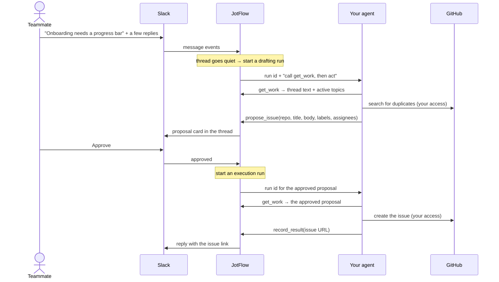

# JotFlow

**Turn team chat into GitHub issues.**

JotFlow is a self-hosted, agent-agnostic bridge between a shared Slack channel and your GitHub repositories. Anyone on the team, engineer or not, drops an idea, bug, or request into the channel. JotFlow watches the conversation, connects follow-up messages and replies to the same topic, and has *your* AI agent draft the corresponding GitHub issue. A human approves it, or the channel is configured to let it through automatically. Either way, the result is posted back to Slack so everyone sees what was created.

> **Status: milestone 1, installable.** Setup and `jotflow run` are ready to use: follow the Quickstart below to connect JotFlow to your Slack workspace. Drafting and approving issues arrives in later milestones; see the [roadmap](docs/roadmap.md). [docs/architecture.md](docs/architecture.md) is the full design.

## Why

- Agents can now generate issues faster than a small team can track them. People still end up pinging each other on Slack to say "I filed this, go look."
- Non-engineers rarely have a coding agent in a terminal. A Slack channel is something they already use.
- GitHub's own Copilot-in-Slack integration does part of this, but it is closed source, only acts when mentioned, and requires a Copilot Business or Enterprise plan. JotFlow is free, open, runs on your infrastructure, and works with whatever agent your team already has.

## How it works

JotFlow is one program you run yourself, with two jobs. It is a Slack app that listens to your channel, and it is the place your own AI agent connects to, to read the work and propose issues. That connection uses MCP, a standard way for agents to use tools. Your agent brings its own GitHub access and does the actual writing. JotFlow never touches GitHub.



One idea, start to finish:



In `auto` mode the Approve step is skipped and the card is posted after the issue exists. Follow-up replies in the thread run the same loop and produce update proposals instead of new issues.

The pieces:

1. **Slack app.** Each team creates their own from the included manifest, named and iconed however they like. It is how JotFlow hears messages and posts back. Slack only talks to installed apps, so this part is unavoidable.
2. **Orchestrator**, the part of JotFlow that coordinates the rest. It waits for a thread to settle before acting, keeps a per-channel index of active topics so related messages land on the same issue, and holds proposals until they are approved.
3. **Whiteboard MCP server.** The agent's only way to act. Tools to fetch the work, propose an issue or an update, link a message to a topic, ask the channel a question, and report the result of a write. Any MCP-capable agent can drive it.
4. **Your agent.** JotFlow starts it in the background, with no window, connected to JotFlow's tools, using a preset for the agent program you use. It reads, drafts, searches your repos for duplicates, and performs the GitHub writes with the access you already gave it.
5. **Approval gate.** Each channel is in `propose`, `auto`, or `paused` mode. It covers the whole lifecycle: creation, description edits, comments, assignment, and labels.

## What a team needs

| Component | Needs | Does not need |
|---|---|---|
| JotFlow | A Slack app in your workspace, created from the included manifest. It reads messages and channel details in the channels you invite it to and looks up user names, over Socket Mode. Its other permissions, to post messages, add reactions, pin a help message and answer one slash command, are for later releases. [manifests/README.md](manifests/README.md) explains each permission. | Any GitHub access |
| Your agent | Whatever GitHub access you already gave it, for example GitHub's MCP server or the `gh` command-line tool | Any Slack access |
| Your machine | Docker to run JotFlow, and uv or Python 3.12 or newer to run the setup once | A public URL or open ports: Socket Mode connects out to Slack |

## Quickstart

**What works today:** JotFlow connects to Slack and logs each message in the channels you choose. It posts nothing in Slack yet, and creates no GitHub issues; both arrive in later milestones.

Setup usually takes ten to fifteen minutes, most of it in Slack's settings pages. It can take longer the first time Docker builds JotFlow, or if your workspace needs an admin to approve new apps. Every name and id below is made up; use your own.

### Words used here

- **Terminal**: the window where you type commands. On macOS it is called Terminal. On Windows, use PowerShell, or a WSL terminal if you use WSL.
- **The repository folder**: the `jotflow` folder that `git clone` creates. Run every command below from inside it.
- **Token**: a long secret string Slack gives your app, like a password for it. Setup asks for two.
- **Scope**: one permission a Slack app has, such as reading messages in channels it was invited to.
- **Socket Mode**: how JotFlow talks to Slack. It connects out to Slack, so your machine needs no public address or open ports.
- **`.env`**: a small file that holds the two Slack tokens. Setup writes it; keep it private.
- **Preset**: the name of the agent program your team runs, such as `claude-code`, so JotFlow knows how to start it.
- **MCP**: the standard way JotFlow and your agent talk to each other. You do not need to set it up.
- **`jotflow.toml`**: JotFlow's settings file: which channels to watch and which GitHub repos they feed. It is plain text in the TOML format, and you can edit it.
- **Label**: a tag on a GitHub issue, such as `bug` or `enhancement`.
- **OAuth**: Slack's name for how an app gets its permissions. It appears in page and token names, such as **OAuth & Permissions** and **Bot User OAuth Token**.
- **Handle**: a Slack name with `@` in front, such as `@idea_bot`, that you type to mention someone or something.
- **Manifest**: a file describing a Slack app: its name, permissions, and settings. Slack builds the app from it, so you don't click through every setting.
- **Docker, image, container**: Docker runs programs in a sealed box called a container. The image is what the box is built from. Docker Compose, the `docker compose` command, starts JotFlow's container with the right settings.
- **Slash command**: a command typed in Slack that starts with `/`, such as `/invite` or `/jotflow help`.
- **Milestone**: a stage on the [roadmap](docs/roadmap.md). Milestone 1, today, connects JotFlow to Slack; drafting issues comes in milestone 3.

### 1. Prerequisites

- **Git**, to download JotFlow. Install it from <https://git-scm.com/downloads>.
- **Docker**, to run JotFlow, with Docker Compose version 2.24 or newer. Docker Desktop includes it: install it from <https://docs.docker.com/get-started/get-docker/>, then start it. On Linux you can use Docker Engine instead: <https://docs.docker.com/engine/install/>. Check with `docker compose version`; a good answer looks like `Docker Compose version v2.29.7`.
  - **On Windows with WSL**, also open Docker Desktop, then **Settings**, **Resources**, **WSL integration**, and switch it on for your Linux distribution, such as Ubuntu. Click **Apply & restart**. Without it, the WSL terminal says `docker` is not found.
  - **On Linux with Docker Engine** instead of Docker Desktop, start Docker with `sudo systemctl start docker`, and let your user run it without `sudo` (which runs one command as the administrator): `sudo usermod -aG docker $USER`, then log out and back in. Otherwise Docker says `permission denied` about `docker.sock`.
- **uv**, which runs setup and fetches Python 3.12 or newer for you. See [uv's installation guide](https://docs.astral.sh/uv/getting-started/installation/). After installing it, open a new terminal so the `uv` command is found. Without uv, you need Python 3.12 or newer; the `python3` built into macOS is often older, so get Python from <https://www.python.org/downloads/>. See step 3.
- Permission to **create apps in your Slack workspace**. If **Create New App** is greyed out at <https://api.slack.com/apps>, ask a workspace admin to allow app creation. Some workspaces also need an admin to approve each new app; see [If your workspace needs admin approval](#if-your-workspace-needs-admin-approval).

### 2. Clone

On Windows with WSL, open a WSL terminal and type `cd ~` first, so you clone into your Linux home directory, not under `/mnt/c`. Files on a Windows drive cannot be kept private from other Windows users, and `.env` holds your tokens.

On Windows in PowerShell, first go to a folder outside OneDrive and Documents, which sync to the cloud, for example `mkdir C:\src; cd C:\src`. Setup later warns that `.env` is on a Windows drive; that is expected there, and the warning says how to keep it private.

```
git clone https://github.com/Jnkman787/jotflow.git
cd jotflow
```

### 3. Run the guided setup

```
uv run jotflow init
```

The first `uv run` downloads Python and JotFlow's packages, so it can sit quietly for a minute before setup starts.

Without uv, create a private Python environment for JotFlow, a `.venv` folder, and install it there. On macOS, Linux, or WSL:

```
python3 -m venv .venv
.venv/bin/pip install .
.venv/bin/jotflow init
```

Without uv, on Windows in PowerShell:

```
py -3.12 -m venv .venv
.venv\Scripts\pip install .
.venv\Scripts\jotflow init
```

Setup starts by saying what it will do, and explains every question just before it asks. `uv run jotflow init --help` shows the same overview. Press Enter to accept the default in brackets, or Ctrl-C to stop. Each question allows five tries; after that setup stops without changing anything, and you can run it again. `.env` and `jotflow.toml` are written only after the last question, so stopping part-way leaves them unchanged. Only the Slack manifest, `slack-app-manifest.json`, is saved earlier, so you can paste it if the link fails.

First, setup asks whether you already created a Slack app for JotFlow. Answer `n` the first time. Then it walks through six setup steps, and prints "Setup step 1 of 6" and so on to match this list:

1. **The bot's name.** This is how the bot appears in Slack, for example `Idea Bot`. It can be up to 35 characters: letters, digits, spaces, `.`, `-` and `_`, starting with a letter or digit. You can change it later in Slack.
2. **Create the Slack app.** Sign in to Slack in your browser first. Setup prints a long link. Open it, pick your workspace, click **Next** if Slack shows it, then click **Create**: the manifest is already filled in. If the link is cut off, doesn't open, or Slack shows an error page, which can happen when a long link wraps across lines in the terminal, go to <https://api.slack.com/apps>, choose **Create New App**, then **From a manifest**, and paste the contents of `slack-app-manifest.json`. To see that file, type `cat slack-app-manifest.json`, or in PowerShell `Get-Content slack-app-manifest.json`, and copy all of it. Setup saved it with your bot name, so use it rather than `manifests/slack-app.json`, which is the default with the name JotFlow.
3. **The app-level token**, which lets JotFlow connect to Slack without a public URL. In the new app's settings, open **Basic Information**, scroll to **App-Level Tokens**, and click **Generate Token and Scopes**. Type any name, for example `socket-mode`; the name is only a label. Click **Add Scope**, choose `connections:write`, click **Generate**, then click **Copy**. It starts with `xapp-`. To see it again later, open **Basic Information**, scroll to **App-Level Tokens**, and click the token's name.
4. **The bot token.** Open **Install App**, click **Install to Workspace**, then **Allow**. Copy the **Bot User OAuth Token** shown on that page; it also appears under **OAuth & Permissions**, which is Slack's page for the app's permissions. It starts with `xoxb-`. If Slack shows **Request to Install** instead, see [If your workspace needs admin approval](#if-your-workspace-needs-admin-approval).

   Paste each token when asked. **Nothing appears as you paste**; that is expected, because tokens stay hidden. In some terminals you paste with a right-click. Then press Enter. Setup checks each token with Slack straight away. If a token is wrong, it says what's wrong and asks again. If a token ever leaks, [manifests/README.md](manifests/README.md) explains how to revoke it.
5. **Channels and repos.** For each channel JotFlow should watch, such as `#ideas`, setup asks for:
   - **the channel id.** Open the channel, click its name at the top, and find the **Channel ID** at the bottom of the **About** tab. It starts with `C`, or `G` for some private channels, for example `C0IDEAS01`. The channel must already exist in Slack. Pasting the channel's link works too, from **Copy link** or from your browser's address bar. The name, such as `#ideas`, does not: setup says `That is the channel's name. Setup needs its id` and asks again. Anything else that isn't an id gets `not a Slack channel id`.
   - **each GitHub repo** that channel feeds, as `owner/name`: the part after `github.com/` in its URL. For example `https://github.com/acme-co/web` is `acme-co/web`. Pasting the link works too.
   - **a nickname**, a short word people type to point at the repo. Later, starting a Slack message with `re: web#42` points it at issue 42 in that repo.
   - **what it covers**, in one sentence, for example `The customer-facing website`. When a channel feeds several repos, the agent uses these sentences to choose one.
   - **labels** a proposal may put on an issue. The default, `any`, allows any label that already exists on the repo. A comma-separated list, for example `bug, enhancement`, narrows it to just those; list only labels that already exist on the repo.
6. **The agent preset.** Your team supplies and controls the agent; JotFlow only needs to know which program it is so it can start it correctly. Agent runs arrive in a later release, milestone 3. Setup accepts `claude-code` today, but it does nothing until then, so press Enter to keep the default, `none`, for now. Any other name is refused for now.

A session looks like this, shortened. Your answers are on the right of each prompt; a hidden token shows nothing.

```
jotflow init sets JotFlow up for your team. It usually takes ten to fifteen
minutes, most of it in Slack's settings pages. It will:
  ...
Have you already created a Slack app for JotFlow? [y/N]:

Setup step 1 of 6: The bot's name
This is how the bot appears in Slack, for example Idea Bot. You can change it later in Slack.
Up to 35 characters: letters, digits, spaces, . - and _, starting with a letter or digit.
Bot name [JotFlow]: Idea Bot

Setup step 2 of 6: Create the Slack app
Sign in to Slack in your browser first. Then open this link, pick your workspace, click Next if Slack shows it, and click Create:

  https://api.slack.com/apps?new_app=1&manifest_json=...

Setup step 3 of 6: The app-level token
  ...
Paste the app-level token (xapp-, hidden):
  App-level token works: Socket Mode can connect.

Setup step 4 of 6: The bot token
  ...
Paste the bot token (xoxb-, hidden):
  Bot token works: @idea_bot in Acme Co.

Setup step 5 of 6: Channels and repos
  ...
Channel id: C0IDEAS01
  GitHub repo (owner/name or link): https://github.com/acme-co/web
  Nickname [web]:
  What it covers: The customer-facing website
  Labels [any]:
  Add another repo to this channel? [y/N]:
Add another channel? [y/N]:

Setup step 6 of 6: The agent preset
  ...
Agent preset [none]:

Saved both tokens to .env. Only your user can read that file.
  Also set COMPOSE_FILE there, so `docker compose up -d` hands jotflow.toml to JotFlow.
Wrote jotflow.toml: 1 channel, 1 repo, no agent preset.
Connected to Slack as @idea_bot in Acme Co.
```

Setup writes two files next to `docker-compose.yml`. Neither is committed to git.

- **`.env`** holds the two Slack tokens. Only you can read it, on a Linux or macOS filesystem. On a Windows drive, such as `C:\` or `/mnt/c` in WSL, that is not enforced: the folder's Windows permissions decide who can read it, and setup says so instead of "Only your user can read that file". Keep the checkout somewhere private, and in WSL prefer your Linux home directory. Setup also adds a `COMPOSE_FILE` line here, so Docker picks up your `jotflow.toml`.
- **`jotflow.toml`** lists your channels and repos. It holds no secrets. Edit it freely: [jotflow.example.toml](jotflow.example.toml) explains every option.

Running `uv run jotflow init` again is safe. It offers to keep tokens that still work and your existing `jotflow.toml`.

#### If your workspace needs admin approval

If Slack shows **Request to Install** instead of **Install to Workspace**, an admin must approve the app before you get the bot token.

1. Click **Request to Install**, then press Ctrl-C in the terminal to stop setup. `.env` and `jotflow.toml` are not written yet, so this is safe. Only `slack-app-manifest.json` was saved, and it is fine to leave.
2. Wait for the admin to approve the app. Slack usually notifies you when they do.
3. Run `uv run jotflow init` again. When it asks `Have you already created a Slack app for JotFlow?`, answer `y`. It then skips the create link, so you don't make a second app. Open your existing app at <https://api.slack.com/apps>, under **Your Apps**, and continue from setup step 3. You can copy the app-level token again from **Basic Information**.

### 4. Invite the bot

In Slack, in each channel you listed, type:

```
/invite @idea_bot
```

Use the bot's handle, which setup printed after `Connected to Slack as`; Slack also suggests it as you type. If Slack asks whether to add the app to the channel, click **Add**. JotFlow never joins channels by itself. Joining a channel is always a person's choice.

### 5. Start JotFlow

Make sure Docker is running first: Docker Desktop, or on Linux the Docker service. Otherwise Docker says `Cannot connect to the Docker daemon`, its name for the background service; start Docker, wait until it says it is running, and try again.

On Windows in PowerShell, setup has already added the `COMPOSE_PATH_SEPARATOR=:` line Docker needs to `.env`. In WSL this doesn't apply.

```
docker compose up -d
```

This starts JotFlow. The agent container, where your team's agent will draft issues, is off until you set it up; agent runs arrive in milestone 3. To set it up, copy `agent.env.example` to `agent.env`, give it mode 0600, fill it in as its comments describe, and add `COMPOSE_PROFILES=agent` to `.env`. `agent.env` holds the agent's own model login and two GitHub tokens, a read-only one and a write one. It never holds Slack tokens, and the agent never sees `.env`.

The first start builds JotFlow's image, which takes a minute or two.

### 6. See it working

```
docker compose logs -f jotflow
```

Post a message in one of your channels. In this release the bot posts nothing back in Slack, so the log is where you see it working. A line like the last one below appears:

```
2026-10-18 09:41:02,118 INFO jotflow.run: watching 1 configured channel(s) as @idea_bot
2026-10-18 09:41:02,604 INFO jotflow.run: connected to Slack over Socket Mode
2026-10-18 09:41:37,250 INFO jotflow.ingest: message channel=C0IDEAS01 ts=1760781697.000100 thread_ts=None
```

In each `message` line, `ts` is the message's id in Slack, which is also the time it was posted, and `thread_ts` is the thread it is a reply in, or `None` for a new message. The log shows where a message was posted and when, never what it says, and never a token. It does show channel ids and your bot and workspace names, so remove those before pasting logs into a public issue. Adding a reaction logs a `reaction` line in the same way. Press Ctrl-C to stop following the log; JotFlow keeps running. Stop it with `docker compose down`.

To run JotFlow without Docker, use `uv run jotflow run` from the same folder instead of steps 5 and 6. It prints the same lines in that terminal, rather than to `docker compose logs`; press Ctrl-C to stop it.

### See it work without Slack

`jotflow replay` runs one of JotFlow's saved example conversations through the same steps a real channel goes through: reading messages, grouping them into topics, and drafting proposals. A scripted stand-in plays the agent. Nothing connects to Slack, GitHub, or the internet.

```
uv run jotflow replay --list
uv run jotflow replay feature-request
```

It prints what happened at each step, `ok` or `FAIL`, and whether the result matches what the example expects. The examples, and the format for saving your own, are described in [src/jotflow/testing/threads/README.md](src/jotflow/testing/threads/README.md).

## Troubleshooting

**Check a fresh install** with the live check. It posts one marked test message to a channel in `jotflow.toml`, checks that JotFlow receives it without logging its text, then deletes it.

1. Stop JotFlow, because Slack gives each message to only one connection, so a running JotFlow would take the test message: `docker compose stop jotflow`, or press Ctrl-C in its terminal if you started it with `uv run jotflow run`.
2. Run the check. It asks before posting; answer `y`.
   - macOS, Linux, or WSL: `JOTFLOW_LIVE_CHECK=1 uv run jotflow check --live`
   - PowerShell: `$env:JOTFLOW_LIVE_CHECK = "1"; uv run jotflow check --live; Remove-Item Env:JOTFLOW_LIVE_CHECK`
3. Read the result. Each line says `ok` or `FAIL`, and a `FAIL` says what to fix.
4. Start JotFlow again: `docker compose start jotflow`

`JOTFLOW_LIVE_CHECK=1` is how you say yes to posting, for that one command only. Never put it in `.env`; the check refuses if it's there. If several channels are listed, pick one with `--channel C0IDEAS01`. Without uv, use `.venv/bin/jotflow`, or `.venv\Scripts\jotflow` on Windows, in place of `uv run jotflow`. In PowerShell, if you stop the check with Ctrl-C, close the window afterwards so the setting does not linger. `uv run jotflow check`, without `--live`, only checks `.env` and `jotflow.toml` and posts nothing.

Every error names what to fix. The common ones are below. Wherever it says `uv run jotflow init`, use `.venv/bin/jotflow init` if you set up without uv.

| You see | What to do |
|---|---|
| `jotflow init is interactive; run it in a terminal.` | Run setup by typing it in a terminal window, not from a script or another program. |
| `uv: command not found`, or uv is not recognized | Open a new terminal after installing uv, so it is found. |
| `ERROR: Package 'jotflow' requires a different Python` | The Python you used is older than 3.12. Install 3.12 or newer from <https://www.python.org/downloads/>, or use uv, which fetches it for you. |
| In WSL, `The command 'docker' could not be found` | In Docker Desktop, open **Settings**, **Resources**, **WSL integration**, switch it on for your distribution, and click **Apply & restart**. |
| `permission denied while trying to connect to the Docker daemon socket` | On Linux, your user isn't allowed to run Docker yet. Run `sudo usermod -aG docker $USER`, then log out and back in. |
| `That is an app-level token (xapp-).` or `That is a bot token (xoxb-).` | The two tokens were swapped. Paste the other one. |
| `The bot token is missing these scopes: ...` or `missing this scope` | The app wasn't created from JotFlow's manifest, or the manifest changed. In the app's settings, open **OAuth & Permissions**, scroll to **Scopes**, and under **Bot Token Scopes** click **Add an OAuth Scope** for each scope named. Slack then shows a banner: click **Reinstall to Workspace** and **Allow**. Setup asks for the bot token again straight away, so copy the new **Bot User OAuth Token** and paste it; you have five tries. If setup has already stopped, run `uv run jotflow init` again. |
| `The app-level token is missing the connections:write scope.` | Generate a new app-level token under **Basic Information**, with the `connections:write` scope. |
| `This token has expired, which means token rotation is on for the app.` | Token rotation is Slack's option to replace tokens every few hours, and JotFlow needs tokens that last. Slack does not let you turn it off once it is on, so create the app again from the link setup prints, run setup again, and delete the old app under **Basic Information**. [manifests/README.md](manifests/README.md) has the details. |
| `Slack does not recognise this token.` | The token was copied incompletely. Copy it again with the **Copy** button. |
| `That is the channel's name. Setup needs its id` | You typed a name such as `#ideas`. Open the channel, click its name, and copy the **Channel ID** from the bottom of the **About** tab. |
| `... is not a Slack channel id such as C0123ABCD` | The id was mistyped. It is a capital `C` or `G` followed by capital letters and digits, such as `C0IDEAS01`. Setup refuses an id typed in lowercase and shows the capitalised form to check, but never guesses. Copy the id exactly as Slack shows it, or paste the channel's link. |
| `could not reach Slack` | Check your network. If your workplace requires a proxy, a server all web traffic goes through, ask your IT team for its address and set it in the terminal before running setup: `export HTTPS_PROXY=http://proxy.acme-co.example:8080`, or in PowerShell `$env:HTTPS_PROXY = "http://proxy.acme-co.example:8080"`. That covers setup only. For JotFlow running in Docker, also add the same line, `HTTPS_PROXY=http://proxy.acme-co.example:8080`, to `.env`, which Docker passes to JotFlow, then run `docker compose up -d` again. |
| `jotflow.toml has problems:` followed by setting names | A hand edit broke the file. Each line names the setting at fault. Fix it, or let setup write a new one. The old file is kept as `jotflow.toml.bak`. |
| `configuration problem in environment or .env:` `JOTFLOW_SLACK_BOT_TOKEN: not set` | `.env` is missing or isn't next to `docker-compose.yml`. Run `uv run jotflow init` in the repository folder. |
| `configuration problem in jotflow.toml:` ``file not found; run `jotflow init` to create it`` | The container didn't get your `jotflow.toml`. Check that `.env` has the `COMPOSE_FILE` line. If you removed it, start with `docker compose -f docker-compose.yml -f docker-compose.policy.yml up -d`. |
| `Cannot connect to the Docker daemon` | Docker isn't running; the daemon is its background service. Start Docker Desktop, or on Linux `sudo systemctl start docker`, wait until it is running, and try again. |
| Compose says the bind source path for `jotflow.toml` does not exist | The bind source path is the file on your machine that Docker hands to JotFlow. Docker was asked to hand `jotflow.toml` to JotFlow, but the file isn't there yet. Run `uv run jotflow init` before `docker compose up -d`. |
| `jotflow.toml` is a directory, or JotFlow reports `Is a directory` | Compose ran before setup, and Docker Desktop created an empty directory in place of the missing file. Stop JotFlow with `docker compose down`. Then remove the directory: `rm -r jotflow.toml`, or `sudo rm -r jotflow.toml` if that is refused, because Docker created it as root, the administrator account. In PowerShell: `Remove-Item -Recurse jotflow.toml`. Then run `uv run jotflow init` and start again with `docker compose up -d`. |
| `Permission denied` on `/etc/jotflow/jotflow.toml` | JotFlow's container runs as its own user and must be able to read the file. Make it readable with `chmod 644 jotflow.toml`; `chmod` changes a file's permissions, and `644` lets everyone read it and only you change it. |
| `not a member of channel C0IDEAS01; invite the bot there with /invite @idea_bot` | Invite the bot to that channel. JotFlow keeps running and watches the channels it is in. |
| `could not look up channel ... the app needs the channels:read and groups:read scopes` | The app was created from an older manifest. Add the two scopes as described for missing scopes above, reinstall the app, and run `uv run jotflow init` again to save the new bot token. |
| `could not listen on 127.0.0.1:8765; is the port in use?`, and `jotflow run` stops | A port is a numbered connection point on your machine. JotFlow uses port 8765 for your agent to connect to, and something else, often a second JotFlow, already holds it. Stop the other one, or pick another port by adding a line such as `JOTFLOW_MCP_PORT=8766` to `.env`. |
| `Slack rejected the bot token (...)` or `Slack refused the Socket Mode connection (...)` | A token was revoked or the app was reinstalled. Run `uv run jotflow init` again to save fresh tokens. |
| `FAIL  receive: no event for the test message` from the live check | First make sure JotFlow is stopped, since a running JotFlow can take the event. Otherwise the app is not getting message events. Check the app's **Event Subscriptions** page, which lists the Slack events it receives, for `message.channels` and `message.groups`, and that Socket Mode is on, then reinstall the app. |
| No `message` lines appear | Check that the channel's id is in `jotflow.toml` and that the bot is in the channel. JotFlow ignores channels it isn't configured for and its own messages. |
| On Windows, Compose ignores the `COMPOSE_FILE` line | `.env` lacks `COMPOSE_PATH_SEPARATOR=:`, which setup adds on Windows. Run `uv run jotflow init` again, or add the line yourself. |

## Using it

This is how JotFlow works for the people in the channel once drafting and approval cards land, in later releases (milestones 3 and 4).

- **Just post.** Write your idea, bug, or request in the channel like you normally would. JotFlow waits for the conversation to settle, then posts a proposed issue for the team to approve.
- **Steer it if you like.** Start a message with `idea:` or `bug:` to say what it is, `re:` to add to an existing issue (JotFlow's link replies tell you exactly what to type), or `skip:` if it isn't an idea at all. Most people never need these.
- **Forgot the words?** Type `/jotflow help`.

Comments and closures on GitHub do not flow back into Slack yet; that is planned after v1.

## Principles

- **Bring your own agent.** JotFlow never calls an LLM itself. You supply the agent and its credentials.
- **JotFlow's code never uses GitHub credentials.** Your agent runs in its own container with its own GitHub access, and never sees JotFlow's Slack tokens. It emits structured proposals through JotFlow's tools. Once a proposal is approved, JotFlow hands it back to your agent, which performs the write with the GitHub access you already gave it and reports the issue URL back. JotFlow never asks the agent to write anything a human has not approved, unless the channel is in `auto` mode.
- **Store pointers, not messages.** JotFlow keeps Slack message timestamps, topic links, issue numbers, and proposal state. It does not store message bodies. Thread text is fetched from Slack on demand, passed to the agent, and discarded. Logs redact message content by default.
- **The local store is a rebuildable cache.** Every issue carries the Slack permalinks it came from; every linked Slack message gets a reply with the issue URL. Delete the database and the correlation map can be rebuilt from Slack and GitHub.
- **No hosted component, no telemetry.** Nothing phones home.

## Roadmap

The plan lives in [docs/roadmap.md](docs/roadmap.md): five milestones from "installable" to "ready for another team," the decisions each rests on, and what done means for each. Work is tracked as GitHub milestones and issues on this repo.

## Contributing

Issues and pull requests are welcome. See [CONTRIBUTING.md](CONTRIBUTING.md), and point your coding agent at [AGENTS.md](AGENTS.md). Security concerns go through [SECURITY.md](SECURITY.md), not public issues.

## License

[Apache-2.0](LICENSE)

JotFlow is an independent open source project. It is not affiliated with or endorsed by Slack Technologies or GitHub, Inc.
