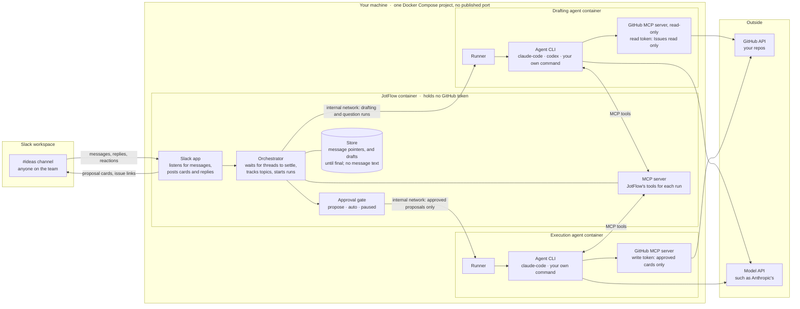
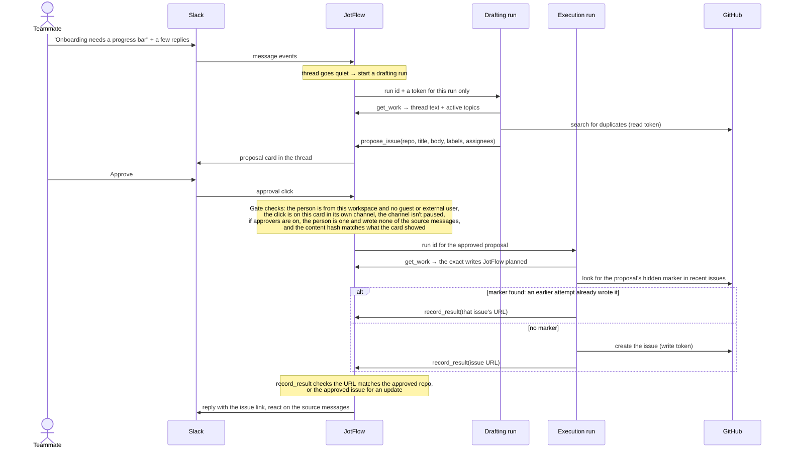

# JotFlow

**Turn team chat into GitHub issues.**

JotFlow is a self-hosted, agent-agnostic bridge between a shared Slack channel and your GitHub repositories. Anyone on the team, engineer or not, drops an idea, bug, or request into the channel. JotFlow watches the conversation, connects follow-up messages and replies to the same topic, and has *your* AI agent draft the corresponding GitHub issue. A human approves it, or the channel is configured to let it through automatically. Either way, the result is posted back to Slack so everyone sees what was created.

> **Status: preparing the first release, 0.1.0.** Setup, drafting, approval cards, and GitHub writes all work: follow the Quickstart below to connect JotFlow to your Slack workspace. The [roadmap](https://github.com/Jnkman787/jotflow/blob/main/docs/roadmap.md) says what's left, and [docs/architecture.md](https://github.com/Jnkman787/jotflow/blob/main/docs/architecture.md) is the full design.

## Why

- Agents can now generate issues faster than a small team can track them. People still end up pinging each other on Slack to say "I filed this, go look."
- Non-engineers rarely have a coding agent in a terminal. A Slack channel is something they already use.
- GitHub's own Copilot-in-Slack integration does part of this, but it is closed source, only acts when mentioned, and requires a Copilot Business or Enterprise plan. JotFlow is free, open, runs on your infrastructure, and works with whatever agent your team already has.

## How it works

JotFlow runs on your own machine as one Docker Compose project, with no port published. JotFlow's own container is a Slack app that listens to your channels, and the place your team's AI agent connects to, to read the work and propose issues. That connection uses MCP, a standard way for agents to use tools. The agent runs in two containers of its own: one drafts with a read-only GitHub token, and one writes only what a person approved. JotFlow holds no GitHub token.

One idea, start to finish:

In `auto` mode the Approve step is skipped and the card is posted after the issue exists. Follow-up replies in the thread run the same loop and produce update proposals instead of new issues.

The pieces:

1. **Slack app.** Each team creates their own from the included manifest, named and iconed however they like. It is how JotFlow hears messages and posts back. Slack only talks to installed apps, so this part is unavoidable.
2. **Orchestrator**, the part of JotFlow that coordinates the rest. It waits for a thread to settle before acting, keeps a per-channel index of active topics so related messages land on the same issue, and holds proposals until they are approved.
3. **Whiteboard MCP server.** The agent's only way to act. Tools to fetch the work, propose an issue or an update, link a message to a topic, ask the channel a question, and report the result of a write. Any MCP-capable agent can drive it.
4. **Your agent.** JotFlow starts it in the background, with no window, connected to JotFlow's tools, using a preset for the agent program you use. It runs in two containers: drafting runs read, draft, and search your repos for duplicates with a read-only token, and execution runs perform the approved GitHub writes with the token that can write.
5. **Approval gate.** Each channel is in `propose`, `auto`, or `paused` mode. It covers the whole lifecycle: creation, description edits, comments, assignment, and labels.

## What a team needs

| Component | Needs | Does not need |
|---|---|---|
| JotFlow | A Slack app in your workspace, created from the included manifest. Over Socket Mode, it reads messages, reactions and channel details in the channels you invite it to, and looks up user names. It posts proposal cards and replies, adds reactions, pins a short help message, and answers the `/jotflow` slash command. [manifests/README.md](https://github.com/Jnkman787/jotflow/blob/main/manifests/README.md) explains each permission. | Any GitHub access |
| Your agent | A model login, such as an Anthropic API key for the `claude-code` preset, and two fine-grained GitHub tokens: one that reads issues, and one that can write them. [The agent containers](https://github.com/Jnkman787/jotflow/blob/main/docs/install.md#the-agent-containers) says how to make them | Any Slack access |
| Your machine | Docker to run JotFlow, and uv or Python 3.12 or newer to run the setup once | A public URL or open ports: Socket Mode connects out to Slack |

## Quickstart

You need Docker with Compose 2.24 or newer, [uv](https://docs.astral.sh/uv/getting-started/installation/), and permission to create apps in your Slack workspace. Turning the agent on also needs an Anthropic API key or a Claude account login (and an OpenAI API key for codex), and two fine-grained GitHub tokens. Setup takes ten to fifteen minutes, and the agent about ten more. **[docs/install.md](https://github.com/Jnkman787/jotflow/blob/main/docs/install.md) has every step in full**, with sample sessions, and [docs/troubleshooting.md](https://github.com/Jnkman787/jotflow/blob/main/docs/troubleshooting.md) covers errors.

1. **[Prerequisites](https://github.com/Jnkman787/jotflow/blob/main/docs/install.md#1-prerequisites).** Install Docker and uv. Check with `docker compose version`.
2. **[Make a folder for JotFlow](https://github.com/Jnkman787/jotflow/blob/main/docs/install.md#2-make-a-folder-for-jotflow).** Run `mkdir jotflow` and `cd jotflow`. On a server, use `/srv/jotflow`.
3. **[Run the guided setup](https://github.com/Jnkman787/jotflow/blob/main/docs/install.md#3-run-the-guided-setup).** Run `uvx jotflow init`. It creates the Slack app from a link, checks both tokens, asks which channels to watch and which repos each feeds, and writes `.env`, `jotflow.toml`, and the Compose files.
4. **[Invite the bot](https://github.com/Jnkman787/jotflow/blob/main/docs/install.md#4-invite-the-bot).** In each channel, type `/invite @your-bot`.
5. **[Check the setup](https://github.com/Jnkman787/jotflow/blob/main/docs/install.md#5-check-the-setup).** Run `uvx jotflow check`. Every line should say `ok`, and a `warn` line says what's missing.
6. **[Start JotFlow](https://github.com/Jnkman787/jotflow/blob/main/docs/install.md#6-start-jotflow).** Run `docker compose up -d`. To turn the agent on, fill in its two files, then follow [Turn the agent on](https://github.com/Jnkman787/jotflow/blob/main/docs/install.md#turn-the-agent-on).
7. **[See it working](https://github.com/Jnkman787/jotflow/blob/main/docs/install.md#7-see-it-working).** Run `docker compose logs -f jotflow`, and post a message in a watched channel.

[docs/usage.md](https://github.com/Jnkman787/jotflow/blob/main/docs/usage.md) covers what people in the channel can do: keywords, reactions, `/jotflow` commands, and asking from a terminal.

## Principles

- **Bring your own agent.** JotFlow never calls an LLM itself. You supply the agent and its credentials.
- **JotFlow's code never uses GitHub credentials.** Your agent runs in its own container with its own GitHub access, and never sees JotFlow's Slack tokens. It emits structured proposals through JotFlow's tools. Once a proposal is approved, JotFlow hands it back to your agent, which performs the write with the GitHub access you already gave it and reports the issue URL back. JotFlow never asks the agent to write anything a human has not approved, unless the channel is in `auto` mode.
- **Store pointers, not messages.** JotFlow keeps Slack message timestamps, topic links, issue numbers, and proposal state. It does not store message bodies. Thread text is fetched from Slack on demand, passed to the agent, and discarded. Logs redact message content by default.
- **The local store is a rebuildable cache.** Every issue carries the Slack permalinks it came from; every linked Slack message gets a reply with the issue URL. That makes the correlation map rebuildable from Slack and GitHub; the `jotflow rebuild` command that does it comes after 0.1.0 (#38), so keep backups until then.
- **No hosted component, no telemetry.** Nothing phones home.

## Roadmap

The plan lives in [docs/roadmap.md](https://github.com/Jnkman787/jotflow/blob/main/docs/roadmap.md): five milestones from "installable" to "ready for another team," then a sixth for what follows v0.1.0, the decisions each rests on, and what done means for each. Work is tracked as GitHub milestones and issues on this repo.

## Contributing

Issues and pull requests are welcome. See [CONTRIBUTING.md](https://github.com/Jnkman787/jotflow/blob/main/CONTRIBUTING.md), and point your coding agent at [AGENTS.md](https://github.com/Jnkman787/jotflow/blob/main/AGENTS.md). Security concerns go through [SECURITY.md](https://github.com/Jnkman787/jotflow/blob/main/SECURITY.md), not public issues.

## License

[Apache-2.0](https://github.com/Jnkman787/jotflow/blob/main/LICENSE)

JotFlow is an independent open source project. It is not affiliated with or endorsed by Slack Technologies or GitHub, Inc.
