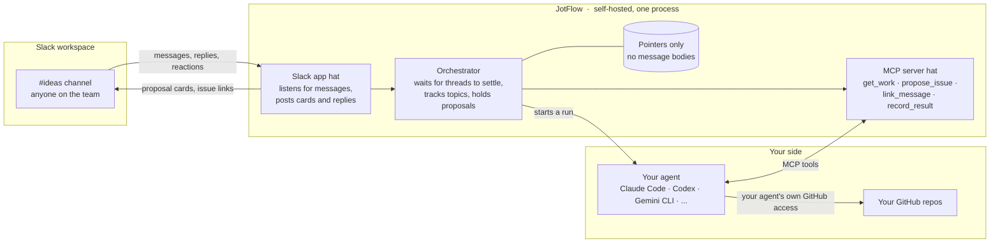
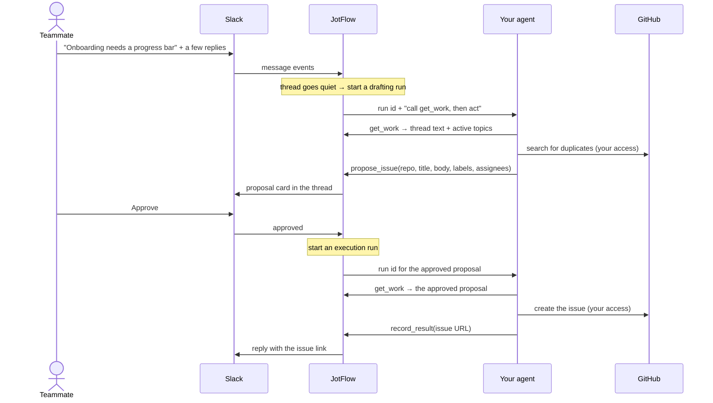

# JotFlow

**Turn team chat into GitHub issues.**

JotFlow is a self-hosted, agent-agnostic bridge between a shared Slack channel and your GitHub repositories. Anyone on the team, engineer or not, drops an idea, bug, or request into the channel. JotFlow watches the conversation, correlates follow-up messages and replies to the same topic, and has *your* AI agent draft the corresponding GitHub issue. A human approves it, or the channel is configured to let it through automatically. Either way, the result is posted back to Slack so everyone sees what was created.

> **Status: design phase.** There is no runnable code yet. The architecture and principles below are the contract the first implementation will be built against. See [docs/architecture.md](docs/architecture.md) for the full design.

## Why

- Agents can now generate issues faster than a small team can track them. People still end up pinging each other on Slack to say "I filed this, go look."
- Non-engineers rarely have a coding agent in a terminal. A Slack channel is something they already use.
- GitHub's own Copilot-in-Slack integration does part of this, but it is closed source, only acts when mentioned, and requires a Copilot Business or Enterprise plan. JotFlow is free, open, runs on your infrastructure, and works with whatever agent your team already has.

## How it works

JotFlow is one self-hosted program wearing two hats: a Slack app that listens to your channel, and an MCP server that your own agent plugs into. Your agent brings its own GitHub access and does the actual writing. JotFlow never touches GitHub.

One idea, start to finish:

In `auto` mode the Approve step is skipped and the card is posted after the issue exists. Follow-up replies in the thread run the same loop and produce update proposals instead of new issues.

The pieces:

1. **Slack app.** Each team creates their own from the included manifest, named and iconed however they like. It is how JotFlow hears messages and posts back. Slack only talks to installed apps, so this part is unavoidable.
2. **Orchestrator.** Waits for a thread to settle before acting, keeps a per-channel index of active topics so related messages land on the same issue, and holds proposals until they are approved.
3. **Whiteboard MCP server.** The agent's only way to act. Tools to fetch the work, propose an issue or an update, link a message to a topic, ask the channel a question, and report the result of a write. Any MCP-capable agent can drive it.
4. **Your agent.** Launched by JotFlow in headless mode with the MCP server attached, using a preset for your CLI of choice. It reads, drafts, searches your repos for duplicates, and performs the GitHub writes with the access you already gave it.
5. **Approval gate.** Each channel is in `propose`, `auto`, or `paused` mode. It covers the whole lifecycle: creation, description edits, comments, assignment, and labels.

## What a team needs

| Component | Needs | Does not need |
|---|---|---|
| JotFlow | A Slack app in your workspace, created from the included manifest: read channel history, post messages, reactions, slash commands, Socket Mode | Any GitHub access |
| Your agent | Whatever GitHub access you already gave it, for example GitHub's MCP server or the `gh` CLI | Any Slack access |

## Principles

- **Bring your own agent.** JotFlow never calls an LLM itself. You supply the agent and its credentials.
- **JotFlow holds no GitHub credentials.** Your agent emits structured proposals through JotFlow's tools. Once a proposal is approved, JotFlow hands it back to your agent, which performs the write with the GitHub access you already gave it and reports the issue URL back. JotFlow never asks the agent to write anything a human has not approved, unless the channel is in `auto` mode.
- **Store pointers, not messages.** JotFlow keeps Slack message timestamps, topic links, issue numbers, and proposal state. It does not store message bodies. Thread text is fetched from Slack on demand, passed to the agent, and discarded. Logs redact message content by default.
- **The local store is a rebuildable cache.** Every issue carries the Slack permalinks it came from; every linked Slack message gets a reply with the issue URL. Delete the database and the correlation map can be rebuilt from Slack and GitHub.
- **No hosted component, no telemetry.** Nothing phones home.

## Roadmap

The plan lives in [docs/roadmap.md](docs/roadmap.md): five milestones from "installable" to "ready for another team," the decisions each rests on, and what done means for each. Work is tracked as GitHub milestones and issues on this repo.

## Contributing

Issues and pull requests are welcome. See [CONTRIBUTING.md](CONTRIBUTING.md), and point your coding agent at [AGENTS.md](AGENTS.md). Security concerns go through [SECURITY.md](SECURITY.md), not public issues.

## License

[Apache-2.0](LICENSE)

JotFlow is an independent open source project. It is not affiliated with or endorsed by Slack Technologies or GitHub, Inc.
