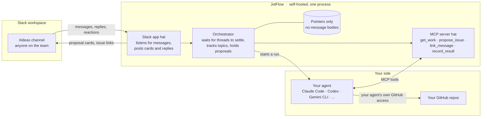
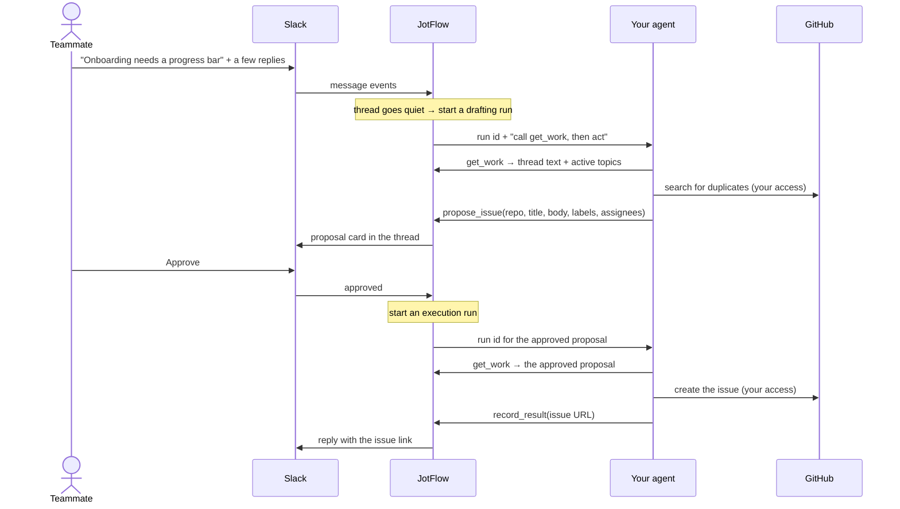

# JotFlow

**Turn team chat into GitHub issues.**

JotFlow is a self-hosted, agent-agnostic bridge between a shared Slack channel and your GitHub repositories. Anyone on the team, engineer or not, drops an idea, bug, or request into the channel. JotFlow watches the conversation, correlates follow-up messages and replies to the same topic, and has *your* AI agent draft the corresponding GitHub issue. A human approves it, or the channel is configured to let it through automatically. Either way, the result is posted back to Slack so everyone sees what was created.

> **Status: milestone 1, installable, in progress.** Setup and `jotflow run` are built and tested offline; the first live check against a Slack workspace is next. Drafting and approving issues arrives in later milestones; see the [roadmap](docs/roadmap.md). [docs/architecture.md](docs/architecture.md) is the full design.

## Why

- Agents can now generate issues faster than a small team can track them. People still end up pinging each other on Slack to say "I filed this, go look."
- Non-engineers rarely have a coding agent in a terminal. A Slack channel is something they already use.
- GitHub's own Copilot-in-Slack integration does part of this, but it is closed source, only acts when mentioned, and requires a Copilot Business or Enterprise plan. JotFlow is free, open, runs on your infrastructure, and works with whatever agent your team already has.

## How it works

JotFlow is one self-hosted program wearing two hats: a Slack app that listens to your channel, and an MCP server that your own agent plugs into. Your agent brings its own GitHub access and does the actual writing. JotFlow never touches GitHub.



One idea, start to finish:



In `auto` mode the Approve step is skipped and the card is posted after the issue exists. Follow-up replies in the thread run the same loop and produce update proposals instead of new issues.

The pieces:

1. **Slack app.** Each team creates their own from the included manifest, named and iconed however they like. It is how JotFlow hears messages and posts back. Slack only talks to installed apps, so this part is unavoidable.
2. **Orchestrator.** Waits for a thread to settle before acting, keeps a per-channel index of active topics so related messages land on the same issue, and holds proposals until they are approved.
3. **Whiteboard MCP server.** The agent's only way to act. Tools to fetch the work, propose an issue or an update, link a message to a topic, ask the channel a question, and report the result of a write. Any MCP-capable agent can drive it.
4. **Your agent.** Launched by JotFlow in headless mode with the MCP server attached, using a preset for your CLI of choice. It reads, drafts, searches your repos for duplicates, and performs the GitHub writes with the access you already gave it.
5. **Approval gate.** Each channel is in `propose`, `auto`, or `paused` mode. It covers the whole lifecycle: creation, description edits, comments, assignment, and labels.

## What a team needs

| Component | Needs | Does not need |
|---|---|---|
| JotFlow | A Slack app in your workspace, created from the included manifest. It reads messages and channel details in the channels you invite it to, posts messages, adds reactions, pins its help message, looks up user names, and has one slash command, over Socket Mode. [manifests/README.md](manifests/README.md) explains each permission. | Any GitHub access |
| Your agent | Whatever GitHub access you already gave it, for example GitHub's MCP server or the `gh` CLI | Any Slack access |
| Your machine | Docker to run JotFlow, and uv or Python 3.12 or newer to run the setup once | A public URL or open ports: Socket Mode connects out to Slack |

## Quickstart

**What works today:** JotFlow connects to Slack and logs each message in the channels you choose. It does not create GitHub issues yet; that arrives in later milestones.

Setup usually takes ten to fifteen minutes, most of it in Slack's settings pages. It can take longer the first time Docker builds JotFlow, or if your workspace needs an admin to approve new apps. Every name and id below is made up; use your own.

### Words used here

- **Terminal**: the window where you type commands. On macOS it is called Terminal. On Windows, use PowerShell, or a WSL terminal if you use WSL.
- **The repository folder**: the `jotflow` folder that `git clone` creates. Run every command below from inside it.
- **Token**: a long secret string Slack gives your app, like a password for it. Setup asks for two.
- **Scope**: one permission a Slack app has, such as reading messages in channels it was invited to.
- **Socket Mode**: how JotFlow talks to Slack. It connects out to Slack, so your machine needs no public address or open ports.
- **`.env`**: a small file that holds the two Slack tokens. Setup writes it; keep it private.
- **Preset**: the name of the agent program your team runs, such as `claude-code`, so JotFlow knows how to start it.
- **MCP**: the standard way JotFlow and your agent talk to each other. You do not need to set it up.

### 1. Prerequisites

- **Git**, to download JotFlow. Install it from <https://git-scm.com/downloads>.
- **Docker**, to run JotFlow, with Compose v2.24 or newer. Install Docker Desktop from <https://docs.docker.com/get-started/get-docker/>, then start it. Check with `docker compose version`; a good answer looks like `Docker Compose version v2.29.7`.
- **uv**, which runs setup and fetches Python 3.12 or newer for you. See [uv's installation guide](https://docs.astral.sh/uv/getting-started/installation/). Without uv, Python 3.12 or newer works too; see step 3.
- Permission to **create apps in your Slack workspace**. Some workspaces need an admin to approve new apps; see [If your workspace needs admin approval](#if-your-workspace-needs-admin-approval).

### 2. Clone

On Windows with WSL, open a WSL terminal and clone into your Linux home directory, for example `~/jotflow`, not under `/mnt/c`. Files on a Windows drive cannot be kept private from other Windows users, and `.env` holds your tokens.

```
git clone https://github.com/Jnkman787/jotflow.git
cd jotflow
```

### 3. Run the guided setup

```
uv run jotflow init
```

The first `uv run` downloads Python and JotFlow's packages, so it can sit quietly for a minute before setup starts.

Without uv, on macOS, Linux, or WSL:

```
python3 -m venv .venv
.venv/bin/pip install .
.venv/bin/jotflow init
```

Without uv, on Windows in PowerShell:

```
py -3.12 -m venv .venv
.venv\Scripts\pip install .
.venv\Scripts\jotflow init
```

Setup starts by saying what it will do, and explains every question just before it asks. `uv run jotflow init --help` shows the same overview. Press Enter to accept the default in brackets, or Ctrl-D to stop. Each question allows five tries; after that setup stops without changing anything, and you can run it again. `.env` and `jotflow.toml` are written only after the last question, so stopping part-way leaves them unchanged. Only the Slack manifest, `slack-app-manifest.json`, is saved earlier, so you can paste it if the link fails.

First, setup asks whether you already created JotFlow's Slack app. Answer `n` the first time. Then it walks through six setup steps, and prints "Setup step 1 of 6" and so on to match this list:

1. **The bot's name.** This is how the bot appears in Slack, for example `Idea Bot`. It can be up to 35 characters: letters, digits, spaces, `.`, `-` and `_`, starting with a letter or digit. You can change it later in Slack.
2. **Create the Slack app.** Sign in to Slack in your browser first. Setup prints a long link. Open it, pick your workspace, click **Next** if Slack shows it, then click **Create**: the manifest is already filled in. If the link is cut off or doesn't open, go to <https://api.slack.com/apps>, choose **Create New App**, then **From a manifest**, and paste the contents of `slack-app-manifest.json`. Setup saved that file with your bot name, so use it rather than `manifests/slack-app.json`, which is the default with the name JotFlow.
3. **The app-level token**, which lets JotFlow connect to Slack without a public URL. In the new app's settings, open **Basic Information**, scroll to **App-Level Tokens**, and click **Generate Token and Scopes**. Type any name, for example `socket-mode`; the name is only a label. Click **Add Scope**, choose `connections:write`, click **Generate**, then click **Copy**. It starts with `xapp-`.
4. **The bot token.** Open **Install App**, click **Install to Workspace**, then **Allow**. Copy the **Bot User OAuth Token** shown on that page; it also appears under **OAuth & Permissions**. It starts with `xoxb-`. If Slack shows **Request to Install** instead, see [If your workspace needs admin approval](#if-your-workspace-needs-admin-approval).

   Paste each token when asked. **Nothing appears as you paste**; that is expected, because tokens stay hidden. In some terminals you paste with a right-click. Then press Enter. Setup checks each token with Slack straight away. If a token is wrong, it says what's wrong and asks again. If a token ever leaks, [manifests/README.md](manifests/README.md) explains how to revoke it.
5. **Channels and repos.** For each channel JotFlow should watch, such as `#ideas`, setup asks for:
   - **the channel id.** Open the channel, click its name at the top, and find the **Channel ID** at the bottom of the **About** tab. It starts with `C`, or `G` for some private channels, for example `C0IDEAS01`. Pasting the channel's link works too. The name, such as `#ideas`, does not: setup says `That is the channel's name. Setup needs its id` and asks again. Anything else that isn't an id gets `not a Slack channel id`.
   - **each GitHub repo** that channel feeds, as `owner/name`: the part after `github.com/` in its URL. For example `https://github.com/acme-co/web` is `acme-co/web`. Pasting the link works too.
   - **a nickname**, a short word people type to point at the repo, as in `re: web#42`.
   - **what it covers**, in one sentence, for example `The customer-facing website`. When a channel feeds several repos, the agent uses these sentences to choose one.
   - **labels** a proposal may put on an issue. The default, `any`, allows any label that already exists on the repo; the agent's instructions say never to invent a label, which JotFlow cannot check itself. A comma-separated list, for example `bug, enhancement`, narrows it to just those; list only labels that already exist on the repo. In `jotflow.toml`, leave the `labels` line out to allow any label; `labels = []` is an error.
6. **The agent preset.** Your team supplies and controls the agent; JotFlow only needs to know which program it is so it can start it correctly. Agent runs arrive in milestone 3, so press Enter to keep the default, `none`, for now. The first preset will be `claude-code`.

A session looks like this, shortened. Your answers are on the right of each prompt; a hidden token shows nothing.

```
jotflow init sets JotFlow up for your team. It usually takes ten to fifteen
minutes, most of it in Slack's settings pages. It will:
  ...
Have you already created the JotFlow app in Slack? [y/N]:

Setup step 1 of 6: The bot's name
This is how the bot appears in Slack, for example Idea Bot. You can change it later in Slack.
Up to 35 characters: letters, digits, spaces, . - and _, starting with a letter or digit.
Bot name [JotFlow]: Idea Bot

Setup step 2 of 6: Create the Slack app
Sign in to Slack in your browser first. Then open this link, pick your workspace, click Next if Slack shows it, and click Create:

  https://api.slack.com/apps?new_app=1&manifest_json=...

Setup step 3 of 6: The app-level token
  ...
Paste the app-level token (xapp-, hidden):
  App-level token works: Socket Mode can connect.

Setup step 4 of 6: The bot token
  ...
Paste the bot token (xoxb-, hidden):
  Bot token works: @idea_bot in Acme Co.

Setup step 5 of 6: Channels and repos
  ...
Channel id: C0IDEAS01
  GitHub repo (owner/name or link): https://github.com/acme-co/web
  Nickname [web]:
  What it covers: The customer-facing website
  Labels [any]:
  Add another repo to this channel? [y/N]:
Add another channel? [y/N]:

Setup step 6 of 6: The agent preset
  ...
Agent preset [none]:

Saved both tokens to .env. Only your user can read that file.
  Also set COMPOSE_FILE there, so `docker compose up -d` mounts jotflow.toml.
Wrote jotflow.toml: 1 channel, 1 repo, no agent preset.
Connected to Slack as @idea_bot in Acme Co.
```

Setup writes two files next to `docker-compose.yml`. Neither is committed to git.

- **`.env`** holds the two Slack tokens. Only you can read it, on a Linux or macOS filesystem. On a Windows drive, such as `C:\` or `/mnt/c` in WSL, that is not enforced: the folder's Windows permissions decide who can read it, and setup says so instead of "Only your user can read that file". Keep the checkout somewhere private, and in WSL prefer your Linux home directory. Setup also adds a `COMPOSE_FILE` line here, so Docker picks up your `jotflow.toml`.
- **`jotflow.toml`** lists your channels and repos. It holds no secrets. Edit it freely: [jotflow.example.toml](jotflow.example.toml) explains every option.

Running `uv run jotflow init` again is safe. It offers to keep tokens that still work and your existing `jotflow.toml`.

#### If your workspace needs admin approval

If Slack shows **Request to Install** instead of **Install to Workspace**, an admin must approve the app before you get the bot token.

1. Click **Request to Install**, then press Ctrl-D in the terminal to stop setup. Nothing is saved, so this is safe.
2. Wait for the admin to approve the app. Slack usually notifies you when they do.
3. Run `uv run jotflow init` again. When it asks `Have you already created the JotFlow app in Slack?`, answer `y`. It then skips the create link, so you don't make a second app. Open your existing app at <https://api.slack.com/apps>, under **Your Apps**, and continue from setup step 3. You can copy the app-level token again from **Basic Information**.

### 4. Invite the bot

In Slack, in each channel you listed, type:

```
/invite @idea_bot
```

Use the bot's handle, which setup printed after `Connected to Slack as`; Slack also suggests it as you type. JotFlow never joins channels by itself. Joining a channel is always a person's choice.

### 5. Start JotFlow

Make sure Docker Desktop is running first. Otherwise Docker says `Cannot connect to the Docker daemon`; start Docker Desktop, wait until it says it is running, and try again.

On Windows outside WSL, add `COMPOSE_PATH_SEPARATOR=:` to `.env` first. Compose separates file names in the `COMPOSE_FILE` line with `;` on Windows, so without it Docker ignores that line and JotFlow cannot find `jotflow.toml`.

```
docker compose up -d
```

The first start builds the image, which takes a minute or two.

### 6. See it working

```
docker compose logs -f jotflow
```

Post a message in one of your channels. A line like the last one below appears:

```
2026-10-18 09:41:02,118 INFO jotflow.run: watching 1 configured channel(s) as @idea_bot
2026-10-18 09:41:02,604 INFO jotflow.run: connected to Slack over Socket Mode
2026-10-18 09:41:37,250 INFO jotflow.ingest: message channel=C0IDEAS01 ts=1760781697.000100 thread_ts=None
```

The log shows where a message was posted and when, never what it says. It does show channel ids and your bot and workspace names, so remove those before pasting logs into a public issue. Adding a reaction logs a `reaction` line in the same way. Press Ctrl-C to stop following the log; JotFlow keeps running. Stop it with `docker compose down`.

To run JotFlow without Docker, use `uv run jotflow run` from the same directory instead of steps 5 and 6.

## Troubleshooting

**Verify a fresh install** with the live check. It posts one marked test message to a channel listed in `jotflow.toml`, confirms JotFlow receives it and logs it without its text, then deletes it. It runs only when you opt in for that run, and in a terminal it asks before posting. Stop JotFlow first. Slack sends each event to only one connection, so a running JotFlow could take the check's event, and while the check is connected JotFlow could miss real messages:

```sh
docker compose stop jotflow
JOTFLOW_LIVE_CHECK=1 uv run jotflow check --live
docker compose start jotflow
```

In PowerShell, set the opt-in for that one command and clear it again:

```
docker compose stop jotflow
$env:JOTFLOW_LIVE_CHECK = "1"; uv run jotflow check --live; Remove-Item Env:JOTFLOW_LIVE_CHECK
docker compose start jotflow
```

If you stop the check with Ctrl-C, the last part never runs and the opt-in stays set in that PowerShell window. Close the window, or run `Remove-Item Env:JOTFLOW_LIVE_CHECK`.

Without uv, replace `uv run jotflow` with `.venv/bin/jotflow`, or `.venv\Scripts\jotflow` on Windows.

Run it on the host, not in the container: it refuses inside JotFlow's image, because Compose passes every `.env` line into the container. That refusal guards against accidents; it is not a security boundary. Keep `JOTFLOW_LIVE_CHECK` out of `.env` and your shell profile; the check refuses when `.env` has it. Ctrl-C at the question cancels without posting. Each step prints `ok` or `FAIL` with what to fix. Add `--yes` to skip the question. If `jotflow.toml` lists several channels, pick one with `--channel C0123ABCD`. `uv run jotflow check` without `--live` only checks `.env` and `jotflow.toml`, and posts nothing. The live check refuses to run when `CI` is set, so it never runs in a pipeline.

Every error names what to fix. The common ones are below. Wherever it says `uv run jotflow init`, use `.venv/bin/jotflow init` if you set up without uv.

| You see | What to do |
|---|---|
| `jotflow init is interactive; run it in a terminal.` | Run setup in a terminal window, not through a pipe or a script. |
| `That is an app-level token (xapp-).` or `That is a bot token (xoxb-).` | The two tokens were swapped. Paste the other one. |
| `The bot token is missing these scopes: ...` or `missing this scope` | The app wasn't created from JotFlow's manifest, or the manifest changed. In the app's settings, open **OAuth & Permissions**, scroll to **Scopes**, and under **Bot Token Scopes** click **Add an OAuth Scope** for each scope named. Slack then shows a banner: click **Reinstall to Workspace** and **Allow**. Run `uv run jotflow init` again and paste the new bot token. |
| `The app-level token is missing the connections:write scope.` | Generate a new app-level token under **Basic Information**, with the `connections:write` scope. |
| `Slack does not recognise this token.` | The token was copied incompletely. Copy it again with the **Copy** button. |
| `That is the channel's name. Setup needs its id` | You typed a name such as `#ideas`. Open the channel, click its name, and copy the **Channel ID** from the bottom of the **About** tab. |
| `... is not a Slack channel id such as C0123ABCD` | The id was mistyped. It is a capital `C` or `G` followed by capital letters and digits. Pasting the channel's link also works. |
| `could not reach Slack` | Check your network. Behind a proxy, set `HTTPS_PROXY` before running setup. |
| `jotflow.toml has problems:` followed by keys | A hand edit broke the file. Each line names the key at fault. Fix it, or let setup write a new one. The old file is kept as `jotflow.toml.bak`. |
| `configuration problem in environment or .env:` `JOTFLOW_SLACK_BOT_TOKEN: not set` | `.env` is missing or isn't next to `docker-compose.yml`. Run `uv run jotflow init` in the repository folder. |
| `configuration problem in jotflow.toml:` ``file not found; run `jotflow init` to create it`` | The container didn't get your policy file. Check that `.env` has the `COMPOSE_FILE` line. If you removed it, start with `docker compose -f docker-compose.yml -f docker-compose.policy.yml up -d`. |
| `Cannot connect to the Docker daemon` | Docker Desktop isn't running. Start it, wait until it says it is running, and try again. |
| Compose says the bind source path for `jotflow.toml` does not exist | Run `uv run jotflow init` before `docker compose up -d`. |
| `jotflow.toml` is a directory, or JotFlow reports `Is a directory` | Compose ran before setup, and Docker Desktop created an empty directory in place of the missing file. Stop JotFlow with `docker compose down` and remove the directory. That may need `sudo`, or Docker Desktop's file access, because Docker created it as root. Then run `uv run jotflow init` and start again with `docker compose up -d`. |
| `Permission denied` on `/etc/jotflow/jotflow.toml` | The container runs as its own user and must be able to read the file: `chmod 644 jotflow.toml`. |
| `not a member of channel C0IDEAS01; invite the bot there with /invite @idea_bot` | Invite the bot to that channel. JotFlow keeps running and watches the channels it is in. |
| `could not look up channel ... the app needs the channels:read and groups:read scopes` | The app was created from an older manifest. Add the two scopes as described for missing scopes above, reinstall the app, and run `uv run jotflow init` again to save the new bot token. |
| `could not listen on 127.0.0.1:8765; is the port in use?`, and `jotflow run` exits with code 3 | Something else, often a second JotFlow, holds the MCP port. Stop it, or set `JOTFLOW_MCP_PORT` to a free port in `.env`. |
| `Slack rejected the bot token (...)` or `Slack refused the Socket Mode connection (...)` | A token was revoked or the app was reinstalled. Run `uv run jotflow init` again to save fresh tokens. |
| `FAIL  receive: no event for the test message` from the live check | First make sure JotFlow is stopped, since a running JotFlow can take the event. Otherwise the app is not getting message events. Check **Event Subscriptions** for `message.channels` and `message.groups`, and that Socket Mode is on, then reinstall the app. |
| No `message` lines appear | Check that the channel's id is in `jotflow.toml` and that the bot is in the channel. JotFlow ignores channels it isn't configured for and its own messages. |
| On Windows, Compose ignores the `COMPOSE_FILE` line | Compose separates file names with `;` on Windows. Add `COMPOSE_PATH_SEPARATOR=:` to `.env`, or use WSL. |

## Using it

This is how JotFlow works for the people in the channel once drafting and approval cards land, in milestones 3 and 4.

- **Just post.** Write your idea, bug, or request in the channel like you normally would. JotFlow waits for the conversation to settle, then posts a proposed issue for the team to approve.
- **Steer it if you like.** Start a message with `idea:` or `bug:` to say what it is, `re:` to add to an existing issue (JotFlow's link replies tell you exactly what to type), or `skip:` if it isn't an idea at all. Most people never need these.
- **Forgot the words?** Type `/jotflow help`.

Comments and closures on GitHub do not flow back into Slack yet; that is planned after v1.

## Principles

- **Bring your own agent.** JotFlow never calls an LLM itself. You supply the agent and its credentials.
- **JotFlow's code never uses GitHub credentials.** Your agent runs in its own container with its own GitHub access, and never sees JotFlow's Slack tokens. It emits structured proposals through JotFlow's tools. Once a proposal is approved, JotFlow hands it back to your agent, which performs the write with the GitHub access you already gave it and reports the issue URL back. JotFlow never asks the agent to write anything a human has not approved, unless the channel is in `auto` mode.
- **Store pointers, not messages.** JotFlow keeps Slack message timestamps, topic links, issue numbers, and proposal state. It does not store message bodies. Thread text is fetched from Slack on demand, passed to the agent, and discarded. Logs redact message content by default.
- **The local store is a rebuildable cache.** Every issue carries the Slack permalinks it came from; every linked Slack message gets a reply with the issue URL. Delete the database and the correlation map can be rebuilt from Slack and GitHub.
- **No hosted component, no telemetry.** Nothing phones home.

## Roadmap

The plan lives in [docs/roadmap.md](docs/roadmap.md): five milestones from "installable" to "ready for another team," the decisions each rests on, and what done means for each. Work is tracked as GitHub milestones and issues on this repo.

## Contributing

Issues and pull requests are welcome. See [CONTRIBUTING.md](CONTRIBUTING.md), and point your coding agent at [AGENTS.md](AGENTS.md). Security concerns go through [SECURITY.md](SECURITY.md), not public issues.

## License

[Apache-2.0](LICENSE)

JotFlow is an independent open source project. It is not affiliated with or endorsed by Slack Technologies or GitHub, Inc.
