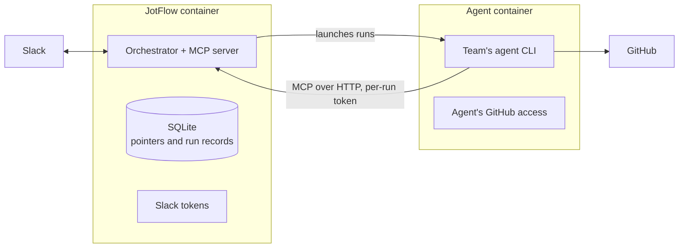
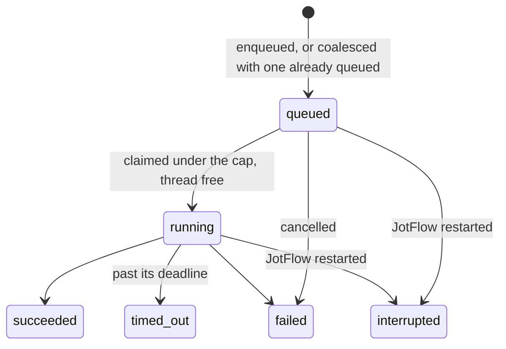
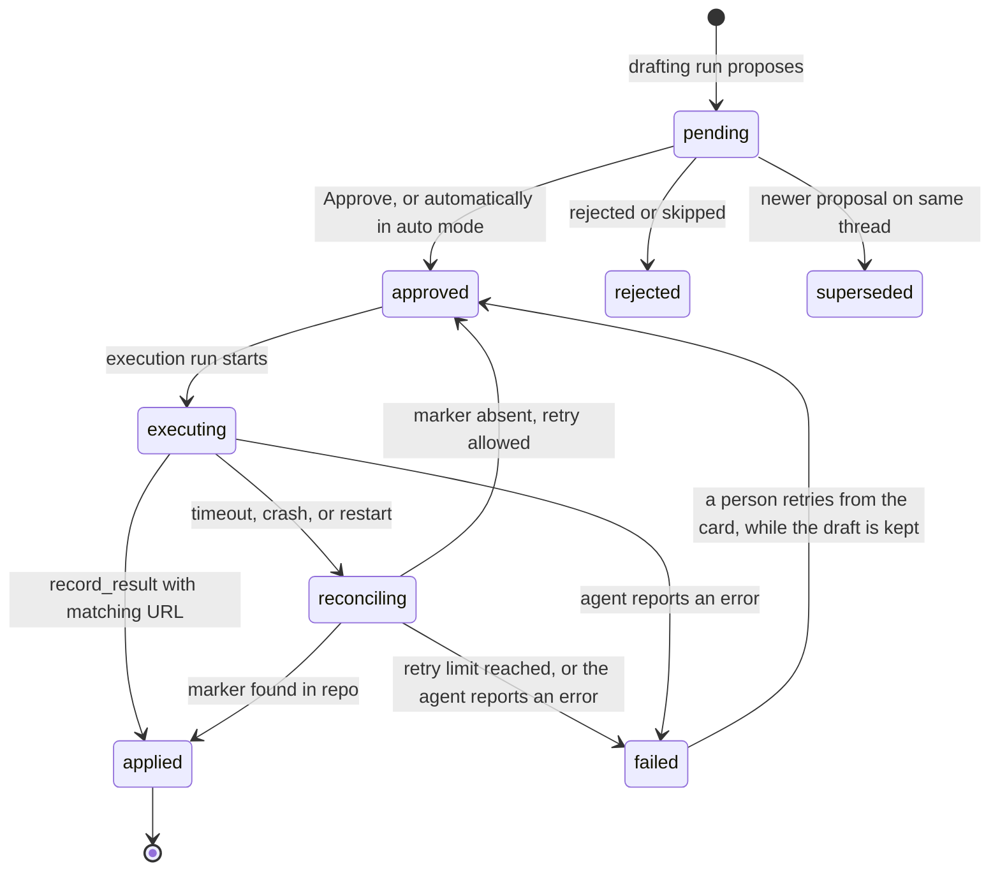

# JotFlow architecture

This document is the design contract the implementation is built against. Change it through a pull request when a decision changes. The build order, milestone definitions, and the numbered decisions D1 to D13 are in [roadmap.md](roadmap.md).

## Problem

A small team wants anyone, including people without a coding agent or GitHub fluency, to propose work by writing in a shared Slack channel. An AI agent should turn those conversations into well-formed GitHub issues, keep the issues current as the conversation continues, and keep the whole team informed without a separate "I filed this" message. The team supplies its own agent. The tool must be usable by any team, with any agent, on their own infrastructure.

## Shape

JotFlow is an **application with an MCP surface**, not an MCP server on its own and not a framework-specific agent.

An MCP server cannot initiate anything; it answers requests from an agent that is already running. JotFlow is event-driven: Slack produces events, something must be listening, hold state across days, debounce bursts, and decide when to invoke an agent. That something is the orchestrator. Tying the project to one agent framework would contradict the goal of working with any agent, so the orchestrator is framework-free and exposes its capabilities over MCP, which every major agent CLI and SDK already speaks.

### Components

**Orchestrator.** A long-running service.

- Subscribes to Slack events for configured channels over Socket Mode. Ignores its own messages and drops events Slack delivers twice.
- Is invite-only: at startup it checks that it is a member of each configured channel and names any it is not in, with the `/invite` instruction, rather than joining. Message edits and deletes are ignored in v1, since editing a message never changes what is approved.
- Parses intent keywords at the start of messages and applies the ones JotFlow handles itself (see Intent keywords).
- Debounces: a thread or loose message is not acted on until it has been quiet for a configurable window, so the first draft already reflects a burst of replies.
- Maintains the **topic index**: a per-channel set of active topics within a rolling window, each with a short generated title and its linked repo and issue number.
- Records every agent run and enforces one run per thread at a time (see Run lifecycle).
- Builds the agent packet: the relevant thread text fetched live from Slack, the compact topic index, and short excerpts of likely-related threads.
- Launches the agent through the configured adapter and records the tool calls it makes.
- Validates proposals, renders Block Kit proposal cards, and handles Approve, Request Changes, and reactions.
- After approval, or immediately in `auto` mode, launches an execution run in which the agent performs the GitHub write.

**Whiteboard MCP server.** Served by the orchestrator process over Streamable HTTP. Tools, subject to change:

| Tool | Purpose |
|---|---|
| `list_topics` | Active topics for a channel with ids, titles, linked issues |
| `get_topic` | A topic's linked Slack messages and issue state |
| `get_work` | The run's packet: new thread text, the active topic index, and related-thread excerpts for a drafting run; only the approved structured proposal for an execution run |
| `propose_issue` | Structured draft: repo, title, body, labels, assignees, size |
| `propose_update` | Structured change to an existing issue: body edit, comment, label or assignee change |
| `link_message` | Associate a Slack message with a topic, or mark it as chatter |
| `ask_channel` | Post a clarifying question into the source thread only |
| `record_result` | Report the issue URL, or the error, after executing an approved proposal |

Every call carries a token, and what a token may do depends on who holds it:

| Token | Issued to | May call |
|---|---|---|
| Drafting run | One drafting run, one channel | `get_work`, `list_topics`, `get_topic`, `propose_*`, `link_message`, `ask_channel` |
| Execution run | One execution run, one approved proposal | `get_work`, `record_result` |
| Question run (M5, D12) | One question run, one channel | `get_work`, `list_topics`, `get_topic`, `ask_channel` (answers in the source thread only) |
| Operator (M5, D12) | A person, created and revoked by an admin, named channels only | `list_topics`, `get_topic` |

Tokens are short-lived for runs and revocable for operators. The server validates `Host` and `Origin` headers so a web page cannot reach it from a browser.

**Run tokens.** The run lifecycle issues one token per run from an in-memory registry and revokes it when the run ends; a time limit, at most two hours, ends it otherwise. A token is `jfr_` followed by 32 random bytes, so secret scanners can recognise a leaked one. The registry keeps only its SHA-256 digest, looks tokens up by that digest so timing reveals nothing about stored tokens, does no I/O, and never logs or prints it. Tokens are not persisted: a restart ends every run, and re-queued runs get fresh tokens. A token's grant names its run, run kind, and channel, plus the thread for a drafting or question run and the one approved proposal for an execution run. A run for a top-level post uses the post's own timestamp as its thread, as Slack does for a thread's parent, so a drafting or question grant always names one thread and tools compare it exactly. Each tool declares the run kinds that may call it, matching the table above. A run lists only its kind's tools, and a call to another kind's tool gets the same error as a tool that does not exist.

**Write tools.** The five write tools are the agent's only way to act, and each one is bounded by the run's grant:

| Tool | Rules |
|---|---|
| `propose_issue` | Needs a topic in the run's channel with no issue yet. Uses only the channel's repos and allowed labels. Sources must come from the run's packet. An assignee must be the linked GitHub login of a participant. Participants are recorded but never become assignees. The new proposal supersedes the thread's older pending ones. At most 3 proposals per run. |
| `propose_update` | Only for the issue the topic is already linked to, with the same repo, label, source, and assignee rules |
| `link_message` | Only messages the run's `get_work` packet served. A person's earlier decision always stands. At most 200 per run. |
| `ask_channel` | Posts only into the run's own thread, with broadcast mentions removed and Slack markup escaped. Never unfurls or turns names into mentions. At most 2 per run, and one per thread every 30 seconds across runs. |
| `record_result` | Execution runs only, for the grant's own proposal while it is executing, or reconciling after a restart. An issue URL must match the approved repo and issue. A result is recorded once. |

Every call also checks that its run is still running, as a second guard behind token revocation. It does not check the deadline: the token's short grace after the deadline lets a run's last call land, such as the result of a write that already happened, while the overdue sweep times the run out. `get_work` does refuse a run past its deadline, so no new work starts late.

Every call is idempotent. A repeat with the same arguments returns the first result and writes nothing, so a retry after the request timeout cannot duplicate a proposal or a question. The write and its ledger entry run in a cancellation-shielded scope, so the timeout cannot cut them apart. The ledger holds ids and states, never message text. A refusal, such as a cap or a topic outside the channel, comes back as a tool result marked as an error, with a reason written in code.

**Transport rules.** `jotflow run` serves the endpoint at `/mcp` on `JOTFLOW_MCP_HOST:JOTFLOW_MCP_PORT`, and a gate in front of the MCP SDK applies these rules to every request before the SDK sees it:

| Request | Answer |
|---|---|
| Carries an `Origin` header | 403. Agents never send one, so this is stricter than an allowlist. |
| `Host` not loopback on the configured port, and not in `JOTFLOW_MCP_ALLOWED_HOSTS` | 403, against DNS rebinding |
| Any method but POST | 405 with `Allow: POST`. There are no sessions, so there is no GET stream and no DELETE. |
| A query string | 400, so a token never travels in a URL |
| `MCP-Protocol-Version` missing or other than `2026-07-28` | 400 with the unsupported-version error listing what is served. The handshake era is not served, so no `Mcp-Session-Id` is ever minted. |
| A body over 64 KiB | 413 |
| No valid `Authorization: Bearer` token | 401 |
| Headers that disagree with the body | 400 `HeaderMismatch`, from the SDK |
| Not finished within 30 seconds | 504 |

The server declares only the `tools` capability, with `listChanged: false`: no prompts, resources, subscriptions, logging, completions, sampling, or elicitation. Tools come from a fixed registry in code, so no runtime content can add a tool or change a description. Every request, admitted or not, writes one audit line with the method, tool, run, status, outcome, and duration, never arguments, bodies, or tokens. Until per-run tokens land (#16), the token check refuses every token, so nothing is reachable.

**Agent adapters.** Thin runners that launch the team's agent with the MCP server attached and a prompt.

- First adapter: a generic command template. Every major agent CLI has a headless mode and reads an MCP configuration, so a team selects their agent by editing one line. Presets ship for Claude Code and Codex CLI first, then Gemini CLI and Copilot CLI.
- A preset defines, per run kind, which of the CLI's tools are allowed. Drafting runs get no shell and no file-write tools, and only the team's read-only GitHub token. Execution runs get the write token, used to create or update one issue. Presets disable session transcripts where the CLI supports it.
- Later: an HTTP adapter and a reference SDK adapter.

**Agent output contract.** The agent acts only by calling the whiteboard MCP tools. JotFlow records each call as it happens; the agent's stdout is ignored. The prompt handed to the agent is minimal: a run id and the instruction to call `get_work` and then act.

**Execution runs.** JotFlow's code never uses GitHub credentials. When a proposal is approved, or immediately in `auto` mode, JotFlow launches the agent again. Its work packet contains only the approved structured fields, never the thread itself. The approved title and body were drafted from Slack and can carry injected text verbatim, so they are passed as labelled content to write, and the execution prompt treats them as content, never as instructions. Every proposal carries a random marker id, written into the issue body or comment as a hidden HTML comment; it is random so it reveals nothing even with `issue_links = "none"`. Before writing, the agent lists the target repo's recently created issues, or the issue's recent comments for an update, and looks for the marker. It lists rather than searches because GitHub's search index lags and a quick retry could miss a fresh issue. Then it performs the write with the GitHub access the team gave it and calls `record_result` with the issue URL. JotFlow checks that the URL points at the approved repo, stores it, replies in the Slack thread, and updates the card. A team may configure a cheaper model for execution runs, since they make a single write.

**Protocol and authorization (D13).** The server implements the current MCP specification's Streamable HTTP transport and pins the protocol versions it serves. It does not use OAuth: JotFlow mints opaque, short-lived bearer tokens for its own runs, so there is no third-party authorization server and no token is ever passed through to another service. It meets the specification's authorization requirements that apply: the token travels in the `Authorization` header on every request, never in a URL; an invalid token gets 401; any request carrying an `Origin` header gets 403, since agents never send one. The tool list is fixed for the lifetime of a run, and the server declares no sampling or elicitation capability.

## Deployment

JotFlow and the agent run in **two containers**, started together by one Compose file (D6).



**How runs start.** JotFlow never mounts the Docker socket, which would give it root on the host and reach into the agent's container. Instead, the agent container runs a small **runner** that listens on the internal Compose network. To start a run, JotFlow sends the runner a run id, run kind, and per-run token; the runner launches the agent CLI with the matching preset and token, and the agent calls back over MCP. The runner accepts only those three fields, never a command. This is part of v1 and separate from the post-v1 HTTP adapter, which lets the runner live on another machine.

**Network.** The MCP server and the runner listen only on the internal Compose network, with no ports published to the host. The MCP server's `Host` allowlist includes its Compose service name. Outside Compose, the MCP server defaults to `127.0.0.1`.

**GitHub tokens.** The agent container holds two GitHub tokens, a read-only one and a write one. The runner passes the read-only token to drafting and question runs and the write token only to execution runs, so read-only drafting does not rest on CLI tool settings alone. Where the agent reaches GitHub through GitHub's MCP server, its read-only mode can serve the same purpose.

The agent container receives an explicit allowlist of environment variables. It never sees JotFlow's `.env`, Slack tokens, or database. JotFlow's container never holds the agent's GitHub token. A prompt-injected agent therefore cannot reach JotFlow's Slack tokens. It can still misuse its own GitHub access within its run kind's tool allowlist; in particular, read-only access during drafting can copy private repo content into a proposal body or a clarifying question in Slack. Channel repo mappings and the agent's read token should cover only repos whose content may be discussed in that channel.

The team decides where both containers run. The only requirements are that JotFlow can start runs in the agent container and the agent can reach JotFlow's MCP port. A split across machines is the post-v1 HTTP adapter.

**The JotFlow image.** The `Dockerfile` builds from `uv.lock` and ships only the virtual environment: no uv, no Node, no agent CLI. It runs as an unprivileged user (uid 10001). `docker-compose.yml` mounts a named volume at `/data` for the database, keeps the root filesystem read-only, drops all capabilities, and publishes no ports. JotFlow joins two networks: `egress` for Slack, and `agents`, which is internal and has no route out. The M3 agent service joins only `agents` plus whatever egress its model and GitHub access need.

**The policy file in Compose.** `docker-compose.policy.yml` mounts the team's `jotflow.toml` read-only at `/etc/jotflow/jotflow.toml` and points `JOTFLOW_CONFIG` at it. Start JotFlow with both files, or set `COMPOSE_FILE` so plain `docker compose up -d` uses both:

```
docker compose -f docker-compose.yml -f docker-compose.policy.yml up -d
COMPOSE_FILE=docker-compose.yml:docker-compose.policy.yml
```

The mount is kept out of `docker-compose.yml` because Docker creates a root-owned directory on the host when a bind-mount source is missing. That directory would block `jotflow init` from writing the file. The base file therefore runs without a policy, for `--version` and image checks. The policy holds no secrets, and the container's user must be able to read it, so the file needs mode `0644`. With `0600`, JotFlow stops with a permission error naming the file.

## Distribution

A team never needs the source code. Each tagged release publishes two artifacts built from the same commit and version:

| Artifact | Published to | Used for |
|---|---|---|
| Python package `jotflow` | PyPI | `uvx jotflow init`, the one-time interactive setup on the team's machine |
| Container image `ghcr.io/jnkman787/jotflow` | GitHub's container registry | `jotflow run`, the always-on service |

`jotflow init` writes `jotflow.toml`, `.env`, and a Compose file pinned to the matching image version, so the whole install is `uvx jotflow init` followed by `docker compose up -d`. The repository is where contributors work; cloning it is only needed to change JotFlow.

JotFlow is a running service rather than an MCP server listed in an agent's configuration, because it must be connected to Slack when no agent session is open, decides when to start the agent, holds state across days, and serves the whole channel. The MCP connection is how the agent talks to JotFlow while a run lasts.

## Intent keywords

People never need syntax: a plain message is classified by the agent. Keywords let them steer explicitly. A keyword is the first word of a message followed by a colon (D10).

| Keyword | Handled by | Effect |
|---|---|---|
| `idea:`, `bug:` | Agent, as a hint | Suggests the kind of issue. The agent may overrule it; the card says when it does. |
| `re:` | JotFlow | Attaches the message to an existing topic or issue in this channel's repos. `re: 42` when unambiguous, `re: web#42` otherwise. |
| `skip:` | JotFlow | Marks the message as not an idea. Its text is kept out of agent packets. On a top-level message it covers the whole thread. |
| `ask:` (M5) | Question run | Read-only question answered in the thread from this channel's topics and repos (D12). |

Post-v1: `hold:` and `go:` to lengthen or shorten the wait before drafting, and `new:` to split a reply off into its own topic.

Rules:

- The colon is required, so sentences like "Skip button is broken" are never read as commands. Typos are tolerated only on keywords of four or more letters.
- JotFlow confirms a recognised keyword with a reaction on the message, so the poster knows it was understood. Reactions never restart the wait before drafting.
- Every keyword has an equivalent reaction, for people who forget or prefer clicking. Reactions from guests and external users are ignored.
- JotFlow strips the keyword before the agent sees the text, and passes the rest as untrusted thread content. A keyword never adds instructions to the agent's prompt.
- No keyword can skip approval or change the channel mode.
- Acting on someone else's message: with approvers off, anyone may, and JotFlow posts a visible note in the thread that the author can undo. With approvers on, only the author or an approver may.
- Editing a message after its card is posted never changes what is approved.
- `/jotflow help` shows the set privately, JotFlow pins a short help message when it joins a channel, and a newcomer's first card carries a one-line keyword tip.
- When JotFlow replies with an issue link, it includes the exact handle to use, for example "reply `re: web#42` to add to this", so nobody needs to know issue numbers.

## Channels and repos

Each channel lists the repos it may feed, each with a nickname and a one-line description of what it covers (D11). The agent picks the repo by matching the thread against those descriptions. The card shows the chosen repo prominently with a dropdown to change it before approving. When the agent is unsure, it asks in the thread. A channel with one repo needs none of this.

## Approval gate

Each channel has a mode:

- `propose`: the bot posts a card with Approve and Request Changes. Nothing is written until approved.
- `auto`: the write happens immediately and the same card follows, so anyone can see what was created and adjust.
- `paused`: the bot reads nothing and writes nothing.

The mode applies uniformly to creation, description edits, comments, assignment, and labels.

**What approval guarantees, always** (D7):

- The card shows the full issue body, the target repo, labels, assignees, size, and confidence. A public target repo shows a warning.
- Approving locks that exact content by hash. The execution run receives only those approved fields.
- The card records who approved and when.
- Guests and external Slack Connect users can never approve.

**Who may approve, configurable** (D7):

| Setting | Approve | Change mode | Self-approval |
|---|---|---|---|
| Approvers off (default) | Anyone in the channel | Anyone in the channel | Allowed |
| Approvers on | Listed approvers | Listed approvers | Not allowed |

Every mode change is announced in the channel. Approval by reaction is off by default and can be turned on.

**Request Changes** opens a dialog whose text JotFlow posts as a thread reply attributed to the person, so the next drafting run treats it like any other message (D9).

**What the gate is and is not.** JotFlow enforces the gate in its own flow: it never hands the agent a proposal to execute until the mode or a person allows it, and it validates proposals against the configured repos, and against a repo's label list where one is set, before posting a card. It is not a credential boundary: the agent holds the team's GitHub access, so a misbehaving agent could still write on its own. D6 narrows this: drafting runs, the ones exposed to raw Slack text, get read-only GitHub access. Teams should still scope the agent's write token to the repositories JotFlow is meant to touch.

**Open mode, stated plainly.** With approvers off, the default, the gate catches agent mistakes but not a single member acting alone: anyone can post text, approve it themselves, or switch the channel to `auto`. In `auto` mode, text from anyone in the channel reaches GitHub with no human review. That fits a small team of equals. Channels with wide membership, guests, or external Slack Connect users should turn approvers on. JotFlow warns in the channel when `auto` is set in a channel that has guests or external members.

## Conversation rules

Defaults that need no syntax (D9):

- A loose top-level message starts a candidate topic. The agent may attach it to an existing one.
- A reply in a thread whose topic has expired revives that topic.
- Expiry only removes a topic from the active index handed to the agent. Its record, a few ids linking messages to an issue, is kept indefinitely so ideas revisited months later still find their issue.
- A follow-up reply in a thread with an issue produces an update proposal, gated like any other.
- The agent sees the thread in question plus short excerpts of likely-related threads, so it can correlate on content rather than titles alone.

## Correlation

This is the novel and risky piece. The agent, not the orchestrator, decides where a message belongs, but the orchestrator constrains the decision.

- Every packet includes the channel's active topic index and related-thread excerpts. The index lists topics with a message linked in the last `topic_window_days` (14 by default), most recently active first and capped at 50. Each entry has its id, title, linked issue, message count, and up to five thread timestamps. It travels as compact JSON with a note that titles were written by earlier runs and are untrusted data (`src/jotflow/orchestrator/topics.py`).
- The agent classifies each new message as: new topic, belongs to topic X, or chatter, and records any keyword hint it overruled and why.
- Below a confidence threshold the agent uses `ask_channel` rather than guessing.
- People override with `re:`, `skip:`, or the equivalent reaction; overrides are recorded so the index stays correct.
- **Reuse before creating.** Before proposing a new issue, the agent looks for an existing home for the idea in two places, regardless of age:
  - GitHub: open and closed issues across all of the channel's repos, searched with its read-only access.
  - JotFlow's topic history: every topic and the issue it became, including expired topics.
- When it finds a likely match, the agent proposes an update to that issue, or asks in the thread whether the idea is the same, instead of drafting a new issue. A closed match is shown as such so a person can decide whether to reopen it or start fresh.
- The card shows the best candidate prominently with a one-click "this is the same as" action, so a duplicate costs one click to resolve.
- This search is separate from the execution-run marker check, which only guards against a crashed run creating the same issue twice within minutes.

## Run lifecycle

Every agent run is recorded in the team's own database (D8).

- A run has a kind (drafting, execution, and from M5 question), a status, a deadline, and its linked proposal. Its timeout is at most two hours, the longest an MCP token lasts, so no run outlives its token.
- The database enforces the per-thread rule, so it holds across a restart or a second process. A partial unique index allows one running run per thread. A top-level post is its own thread: its run carries the post's own ts, which is also the `thread_ts` Slack gives every reply to it, so a post and its replies share one lock. A burst during a run coalesces into one queued follow-up. An approved proposal has at most one queued or running execution run.
- At most one run per thread at a time, of any kind, including execution. A follow-up reply arriving while an issue is being created waits until the issue number exists, so it can become an update proposal rather than a second new issue. Messages arriving during a run trigger a fresh run afterwards, and the newer proposal supersedes the older pending one.
- A total concurrency cap, `[agent] max_concurrent_runs` in `jotflow.toml` (default 2), limits how many agent processes run at once. The oldest queued run whose thread is free starts first.
- On restart, every queued or running run is marked interrupted. Each thread with an interrupted drafting run gets one fresh drafting run. Every proposal that is approved, executing, or reconciling then gets one fresh execution run, whether or not its last run was recorded. That also covers a crash between approving a proposal and queuing its run. A proposal that was executing moves to reconciling first, through the same transition rules as everywhere else, so the next attempt checks for the proposal's hidden marker before writing. A proposal still approved never started its write and stays approved. Any other proposal gets no new run.
- Run states:



- Proposal states and transitions:



In `auto` mode a validated proposal moves from pending to approved without a person, and the card records "approved by auto mode".

## Data and privacy

JotFlow stores pointers and derived metadata, never Slack message bodies.

Stored, in the team's own database:

- channel id, message timestamp, thread timestamp, mapped to a topic id
- topic id mapped to a repo and issue number, plus a short generated title
- proposals: structured fields, state, approver, content hash
- run records, identity links, and per-channel settings

Not stored by JotFlow: message bodies, channel history.

The store (`src/jotflow/store/`) enforces this. Every column carries a comment saying what it holds, and a test reads the live schema and fails if any column is named or documented as a message's body, text, or content. The proposals table holds the agent's structured draft, the issue title and body that a person approves, because approval must lock exactly what the card showed (D7). That draft is derived content bound for GitHub, not a copy of the thread. Topic titles are cleaned on every write: no markup, links, or mentions, and at most 80 characters, because a title written by one run is read by others.

**Retention of drafts (#102).** A draft can quote what people wrote, so it stays only while it is needed. When a proposal is applied, rejected, or superseded, its drafted title, body, and comment are removed in the same transaction; an applied issue's text already lives on GitHub. A failed proposal keeps its draft so a person can retry it, until the draft is cleared explicitly, after which a retry is refused. What stays is the audit trail: the content hash of what was approved, the approver and time, the state, the result and issue URL, the Slack pointers, the participants, and the non-text fields such as repo, labels, and assignees. The database runs with `secure_delete`, so removed text is overwritten rather than left in free pages, and after every clear the store checkpoints and truncates its write-ahead log, so no earlier copy of the page stays in the `-wal` file while JotFlow runs.

Thread text is fetched from Slack when building a packet, passed to the agent, and discarded. Logs redact message bodies by default.

The local store is a **rebuildable cache**. Each linked Slack message receives a reply with the issue URL, and by default each issue carries the Slack permalinks it came from, so the correlation map can be reconstructed from Slack alone. Setting `issue_links = "none"` keeps permalinks and every other workspace detail out of issue bodies.

Where conversation content does go, so teams can judge it:

- **The agent's model provider.** If the agent uses a hosted model, thread text goes to that vendor under the team's own agreement. JotFlow sends only the thread in question and short excerpts of related threads, never channel history.
- **GitHub.** Issue bodies summarise the conversation they came from. If the target repo is public, that summary is public; the card warns when it is.
- **The agent's host.** Some agent CLIs save session transcripts. Presets turn this off where the CLI allows it; where it does not, transcripts stay in the agent container.

There is no hosted component and no telemetry. Nothing is sent to the JotFlow project.

## Permissions

| Component | Needs | Does not need |
|---|---|---|
| JotFlow | A Slack app installed in the team's workspace: `channels:history`, `groups:history`, `channels:read`, `groups:read`, `chat:write`, `reactions:read`, `reactions:write`, `pins:write`, `users:read`, `commands`, and from M5 `app_mentions:read`, plus an app-level token for Socket Mode | Any GitHub access |
| Team's agent | Two GitHub tokens: a read-only token for drafting runs and a write token for execution runs, both scoped to the channel's mapped repos | Any Slack access |

Each team creates a dedicated Slack app for JotFlow from the manifest in this repository, inside their own workspace. The bot's display name and icon are theirs to choose; "JotFlow" is only the manifest default. The app stays internal to that workspace and is never distributed. Reusing an existing app is not supported: scopes, event subscriptions, and slash commands would have to be merged by hand and would collide with whatever the app already does. Slack requires two manual steps that no software can skip, creating the app and clicking Allow on the install screen, so `jotflow init` wraps everything around them: it renders the manifest, opens the create-from-manifest link, validates the pasted tokens, and writes the environment file.

JotFlow must be a Slack app because something has to be woken when a message is posted. Slack's MCP server is pull-only: an agent that is already running can read, search, or post through it, but nothing in it fires on a new message. Only an installed app can subscribe to events. The agent needs no Slack access because JotFlow fetches thread text, hands it over through `get_work`, and does all posting itself.

## Configuration

Two tiers, because every team supplies every value and the two kinds change at different speeds.

| Tier | Lives in | Changed by | Holds |
|---|---|---|---|
| Policy | `jotflow.toml`, deployed with the service | An admin editing the file | Each channel's repos with nickname and description, optional label lists, optional approver list, reaction approval, `issue_links`, debounce window, topic window, agent preset and run concurrency cap |
| Runtime | The local database | Slack slash commands | Channel mode (`propose`, `auto`, `paused`), Slack to GitHub identity links |

The policy file is validated in full at startup. An unknown or misspelt key is an error, and every error names its key, such as `channels.C0123ABCD.repos[0].nickname`. Channels are keyed by Slack channel id; each lists its repos. A repo's `labels` list is optional: without one, a proposal may use any label that already exists on the repo, and a list narrows that set. An explicit empty list is an error, because it could mean either; leaving the key out is the only way to say "any". Lists are per repo because labels are per repo on GitHub. JotFlow holds no GitHub credentials, so it cannot see which labels exist. The agent's rule is to never invent a label: drafting runs read the repo's labels with read-only access, and the execution run checks each label exists before applying it, since GitHub would otherwise create a missing one. That is a prompt rule, not something JotFlow enforces. JotFlow enforces a label list where a team has set one, and always rejects label names with control characters, line breaks, bidirectional overrides, invisible format characters such as zero-width spaces, or surrounding spaces. An empty approver list means approvers are off. [`jotflow.example.toml`](../jotflow.example.toml) is a complete, commented example. The environment tier holds only the Slack tokens, the MCP host and port, `JOTFLOW_MCP_ALLOWED_HOSTS` (extra `Host` names for the MCP server, such as the Compose service name), the database path, and `JOTFLOW_CONFIG`, the path to the policy file.

Setup is a first-class feature: `jotflow init` asks a few questions, checks the Slack tokens, and writes `.env` and `jotflow.toml`, and the Slack app manifest installs in a couple of clicks. The written `jotflow.toml` is checked by the same loader `jotflow run` uses, so it always loads. A team should go from clone to connected bot without reading source.

## Identity

Assignment requires a Slack user to GitHub handle mapping. A self-service slash command lets each person link their own account. Links are self-declared in v1, and cards mark them as unverified.

## Security posture

- Slack content is untrusted input. It reaches only drafting runs. The shipped presets configure drafting runs with read-only GitHub access and no shell or write tools, and execution runs, which can write, receive only the approved structured fields, never the thread itself; because the approved body was drafted from Slack, the execution prompt treats it as content to write, never as instructions. This holds only when the team gives the agent separate read and write GitHub tokens, and only for the shipped presets; a custom command template is the team's responsibility.
- The agent runs in its own container with an environment allowlist and no access to JotFlow's secrets.
- Proposals are validated against the configured repos, and against a repo's label list where one is set, before they can be approved, and a reported issue URL must point at the approved repo.
- `ask_channel` posts only in the source thread, strips broadcast mentions such as `@channel`, and is rate-limited.
- MCP tokens are scoped to their run kind and channel; the server validates `Host` and `Origin`.
- Issues and comments are created by the team's agent under whatever identity its GitHub credentials carry, with the proposing Slack user named in the body.
- No secrets in the repository. Configuration is by environment variables. JotFlow's code never uses GitHub credentials.
- Continuous integration runs on forked pull requests with a read-only token. The `pull_request_target` trigger is never used to check out fork code.

## Deferred

- Two-way sync from GitHub comments back into Slack threads.
- Per-action approval granularity.
- Other chat platforms. The orchestrator's Slack dependency should stay behind an interface so this is possible later.

## Stack

Python 3.12 or newer.

| Concern | Choice | Why |
|---|---|---|
| Slack | slack-bolt (AsyncApp, Socket Mode) | Maintained by Slack. Socket Mode means no public URL for self-hosted installs. |
| MCP | the official `mcp` package (2.x), its low-level `Server` over Streamable HTTP | Tool schemas derive from the same Pydantic models used everywhere else. Not `MCPServer`, the 2.x name for FastMCP: it always registers prompt, resource, and subscription handlers, so the server would advertise capabilities JotFlow must not offer. |
| GitHub | none | JotFlow's code never uses GitHub credentials. The team's agent performs reads and writes with its own tooling. |
| State | SQLite via aiosqlite | Pointers and run records. Postgres stays possible behind the same interface. |
| Tooling | uv, ruff, mypy strict, pytest | Locked dependencies, one formatter, typed contracts. |

The Pydantic models in `src/jotflow/models.py` are the single source of truth for the MCP tool contract, the validation applied before a card is posted, and the shape rendered into Slack approval cards.

Package layout:

```
src/jotflow/
  models.py       shared contracts: proposals, runs, classifications, topics, channel modes
  config.py       environment-driven settings, no secrets in the repo
  policy.py       jotflow.toml schema, loader, and allowlist lookups
  cli.py          entry point
  orchestrator/   event ingest, keywords, debouncing, topic index, run lifecycle, approval cards
  whiteboard/     the MCP server and token scoping
  adapters/       agent runners and presets
  execution/      execution runs and result checks
```

The major agent CLIs install through npm, so the agent container carries Node. The JotFlow container does not need it.
