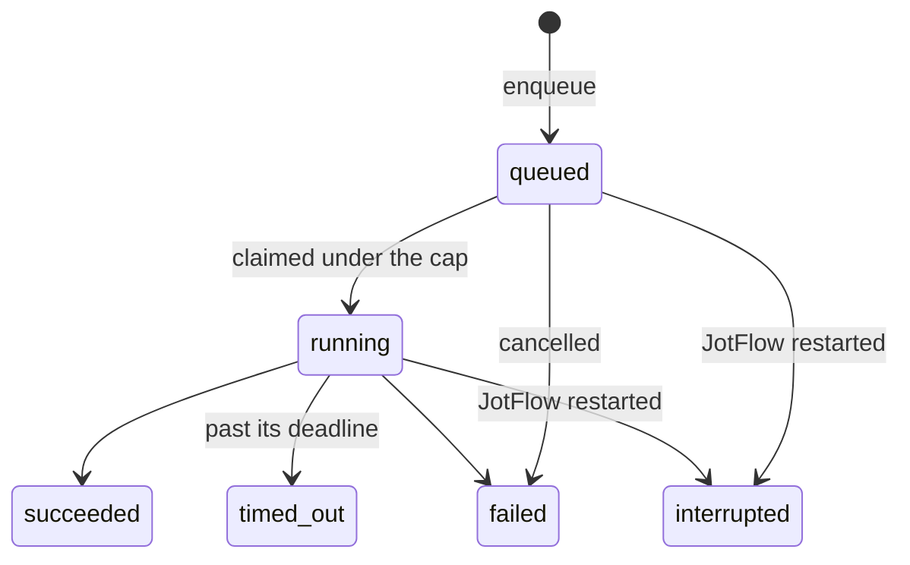

# Run records, one run per thread, and restart recovery

## Links and status

- Issue: #53
- Draft PR: #104
- Status: completed
- Last verified: `make check` green locally after rebasing onto #97: 831 tests, store modules at 100%
- Next safe action: review and merge #104; then the run-timeout ceiling follow-up, capping at `whiteboard.tokens.MAX_TOKEN_TTL_SECONDS`

## Objective and done-when

Every agent run is persisted (D8): its kind, status, deadline, and linked proposal. At most one run per thread runs at a time. A message that arrives mid-run queues a fresh run for afterwards. A configurable cap limits how many runs run at once. After a restart, interrupted runs are recovered.

Done when:

- [x] Run records survive a restart
- [x] Interrupted drafting runs are re-queued on startup; interrupted execution runs are marked for reconciliation
- [x] Two bursts on the same thread never produce parallel runs
- [x] Concurrency cap configurable

**Out of scope:**

- launching agents (#21)
- per-run tokens (#16), though their shape is agreed with security in the #97 review
- the debouncer that decides when to queue (#19)
- what an execution retry does after reconciling (#30)
- the supersede logic itself, which the store already has from #96

## Design

References: D8 in [roadmap.md](../roadmap.md); Run lifecycle in [architecture.md](../architecture.md); the store contract from #96.

**Statuses and transitions.** These rules live in `store/base.py` as `ALLOWED_RUN_TRANSITIONS`, beside the proposal rules:

**Rules the database enforces, so they hold across processes:**

- At most one running run per thread, of any kind: a partial unique index on `(channel_id, thread_ts)` where the status is `running`. A top-level post is its own thread, and its run carries the post's own ts, the same `thread_ts` Slack gives its replies. `thread_ts` is never null. This was changed in review; see Validation.
- At most one queued drafting run per thread. A burst during a run queues one follow-up, not one per message.
- At most one queued or running execution run per proposal.
- An execution run always names its proposal.

**Store methods**, added to the `Store` protocol with both implementations and contract tests:

| Method | Does |
|---|---|
| `enqueue_run(kind, channel_id, thread_ts, *, proposal_id=None, timeout)` | Adds a queued run, or returns the one already queued for that thread, or for that proposal if it is an execution run. Idempotent, so a burst coalesces. |
| `claim_next_run(*, max_running)` | One transaction. If fewer than `max_running` runs are running, it takes the oldest queued run whose thread has no running run. It marks that run running, sets `started_at` and `deadline = started_at + timeout`, and returns it. Otherwise it returns `None`. |
| `finish_run(run_id, status, *, error=None)` | A compare-and-set from `running`, or from `queued` for a cancel, to a final status. It returns `None` if the run already finished, so a late timeout and a late success cannot both win. |
| `get_run`, `thread_runs` | Reads. |
| `overdue_runs()` | Running runs past their deadline, for the supervisor to time out. |
| `recover_runs()` | Run once at startup, in one transaction. See below. |

**Restart recovery** (`recover_runs`) returns what it did, so `jotflow run` can log it:

- Every queued or running run becomes `interrupted`.
- For each thread that had an interrupted drafting run, one fresh drafting run is queued.
- For each interrupted execution run:
  - A proposal that is `executing` moves to `reconciling`. The next attempt checks the hidden marker before writing, per the architecture diagram.
  - A proposal still `approved` stays so; that run never started its write.
  - Every approved, executing, or reconciling proposal then gets one fresh execution run, including one whose run was never queued. This was changed in review.
- Proposals in any other state are left alone, and no run is queued for them.

**Configuration.** `[agent] max_concurrent_runs` in `jotflow.toml`, default 2, from 1 to 32. Default timeouts are constants for now: drafting 10 minutes, execution 5 minutes.

**Migration.** The `runs` table is migration 3. Product's #103, for #102, merged first and took 2, as agreed: first to merge takes the lower number. Migration numbers stay 1 to N with no gaps.

**Privacy.** No column holds message text. `error` is the agent's failure reason, bounded to 2000 characters and documented as untrusted. `tests/test_store_schema.py` checks the new table.

Alternatives considered:

- A lock in process memory. It would not survive a restart or a second process, and the unique index enforces the rule in the database itself.
- One queued run per thread of any kind. That would let a drafting run block an approved execution in the same thread.

## Risks and open questions

- `claim_next_run` picks the oldest eligible run. A thread with constant bursts cannot starve others, because each burst coalesces into one queued run.
- The `ALLOWED_TRANSITIONS` for proposals has no `approved` to `reconciling` edge. Recovery leaves a still-approved proposal as it is, so no new edge is needed.
- No open decisions.

## Progress checklist

- [x] Confirm the issue is ready: bounded objective, testable done-when, no open decision
- [x] Commit this plan and open the draft PR
- [x] Migration with the `runs` table and indexes
- [x] Run rules in `store/base.py`; the protocol methods
- [x] SqliteStore and MemoryStore implementations
- [x] Contract tests, including the restart test against a file database
- [x] `max_concurrent_runs` in the policy, the example, and docs
- [x] Update architecture.md Run lifecycle with the run diagram
- [x] `make check` passes
- [x] Local CodeRabbit review, or skipped
- [x] Mark the PR ready for review

## Validation

- `make check` passes, with 780 tests and total coverage at 98.19%. `store/base.py`, `memory.py`, `sqlite.py`, and `migrations.py` are each at 100%.
- `tests/test_store_runs.py`, 42 tests, runs every case against both stores:
  - enqueue, coalescing for drafting, loose posts, execution, and questions, custom timeouts, and bad requests
  - claim order
  - two bursts on one thread never running in parallel, which covers the done-when box
  - the lock covering execution runs
  - the next run starting only after the first ends
  - other threads proceeding
  - the cap
  - eight concurrent claims starting exactly one run
  - finish for each status, a late second finish losing, cancel-only for queued runs, bounded errors
  - overdue runs, and thread listing
  - recovery: drafting re-queued once per thread, an executing proposal moved to reconciling with a fresh execution run, an approved one retried unchanged, settled and missing proposals not retried, questions not re-queued, finished runs left alone
- SQLite only:
  - runs survive closing and reopening the database file, then recover and claim
  - the database itself rejects two running runs on one thread, and an execution run without a proposal
- The schema test covers the new table: every column commented, none named or documented as message content.
- Policy: `max_concurrent_runs` defaults to 2, bounds 1 to 32 are reported by key, and it round-trips through the writer. A re-run of `jotflow init` now keeps it. The test fails without that fix, which was checked by reverting the line.
- CodeRabbit (local CLI, `--committed --base main -c AGENTS.md`): 1 finding, fixed. The architecture text now says which interrupted execution runs get a fresh run.

### Review changes (reviewer, at 9340a8d)

- **Blocker: loose posts.** The indexes keyed runs on `coalesce(thread_ts, '')`, so every loose post in a channel shared one slot. Worse, a drafting run for post X keyed `(C, '')`, while a reply to X keyed `(C, X.ts)`, so both could run at once on one conversation.

  Fixed by following Slack's convention: a top-level post is its own thread, and its run carries the post's own ts. `Run.thread_ts` and `runs.thread_ts` are now required, NOT NULL, and the coalesce is gone. Tests now show that two top-level posts get two runs, that a reply waits for its post's run, that the same ts in another channel is another thread, and that an empty `thread_ts` is refused.
- **Nit: recovery used raw updates.** Recovery moved executing proposals to reconciling with a raw UPDATE. It now goes through `plan_transition`, so future transition rules apply there too.
- **Nit: an approved proposal with no run.** Recovery queued an execution run only for proposals that had an interrupted run, so a crash between approving and queuing left an approved proposal stranded. Recovery now queues one execution run for every approved, executing, or reconciling proposal, keeping the interrupted run's timeout where there was one. Tests cover a never-queued approved proposal, two waiting proposals, and the kept timeout.
- CI found a real ordering bug on 3.13 and 3.14. Runs queued in the same instant were claimed in random-id order in SQLite, not first in, first out; the memory store kept insertion order. Ties now break by `rowid`, and a new test checks that three runs queued at once start in order. `test_overdue_runs`, which depended on that order, is now deterministic.
- **Second blocker: proposals had the same gap.** `ProposalRecord.thread_ts` was nullable and nothing rejected `None`, so recovery silently skipped a waiting proposal drafted from a top-level post.

  The same rule now applies to proposals: `thread_ts` is required, a top-level post uses its own ts, and `check_new_proposal` rejects an empty one. The silent skips are gone. `thread_proposals` and `supersede_pending` take a `str` thread and match it exactly. No migration is needed, because the model and the check guard every write. A contract test rejects `None` and `""`.
- After both rounds of review: 849 tests pass, and every store module is at 100%.

- **Rebase onto `main`, after #103, #105, and #110.**
  - The branch was squashed to one commit first.
  - The runs table became migration 3.
  - `supersede_pending` keeps #103's draft clearing together with the exact thread match.
  - The example config keeps #108's commented-out preset and adds `max_concurrent_runs`.
  - The config table lists the topic window and the run cap.
  - 951 tests pass.
- The team lead decided to keep the recovery that queues approved proposals with no run, and noted on #30 that #104 does it.

## Handoff notes

- **Migration number.** The runs table is migration 3, after #103's migration 2. `migrate` refuses gaps, so a mistake fails loudly.
- **For the runner, #21:**
  - At startup, call `recover_runs()` once, before anything claims.
  - Loop: `claim_next_run(max_running=policy.agent.max_concurrent_runs)`, launch, then `finish_run`.
  - Poll `overdue_runs()` and finish each as `timed_out`.
- **For #16 and #107.** Issue a token at claim time, and revoke it in `finish_run`'s caller. Tokens need not survive a restart, because recovery re-queues runs with fresh ones.
  - The grant's `thread_ts` is the run's `thread_ts`, which is always set: a top-level post uses its own ts. An execution grant names its proposal.
  - Issue with ttl = run deadline minus now, plus a small grace, capped at `whiteboard.tokens.MAX_TOKEN_TTL_SECONDS`.
  - The store's run-timeout ceiling, one day today, should drop to that same cap once #105 merges.
- **For #30.** An execution run claimed for a `reconciling` proposal must check the marker first. The store leaves that proposal in `reconciling`, and the existing proposal transitions decide where it goes next.
- **`init.py`.** One line changed so a re-run keeps agent settings other than the preset. Product was told.
